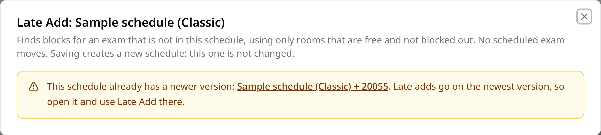
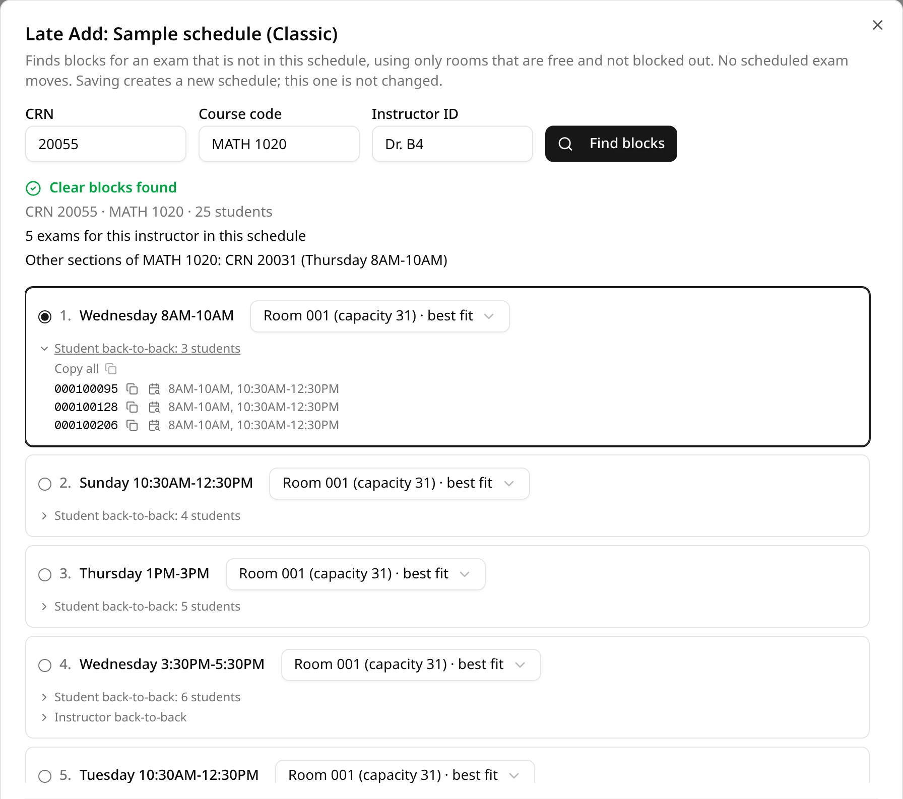
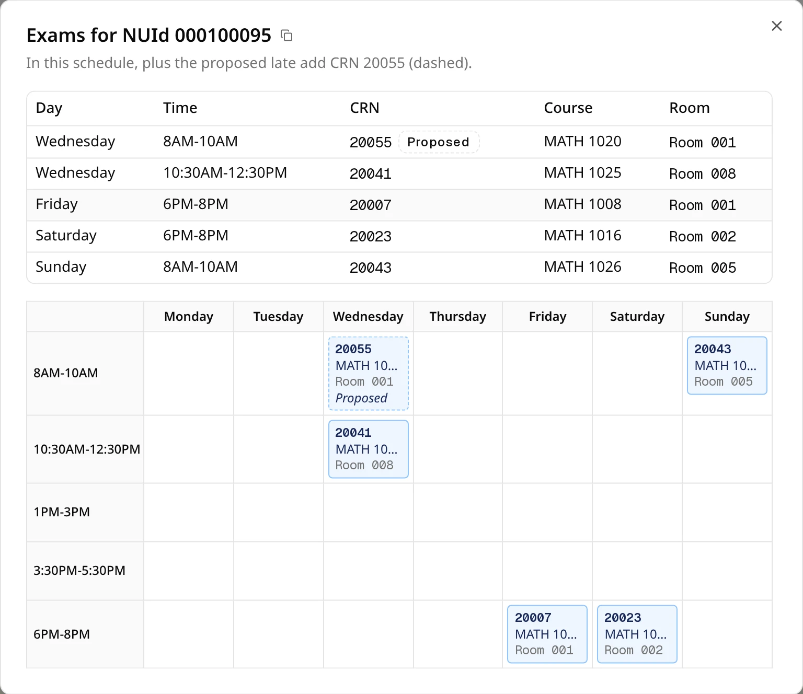
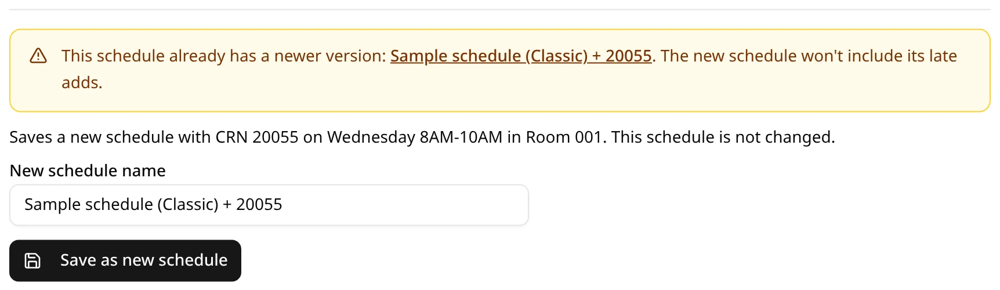
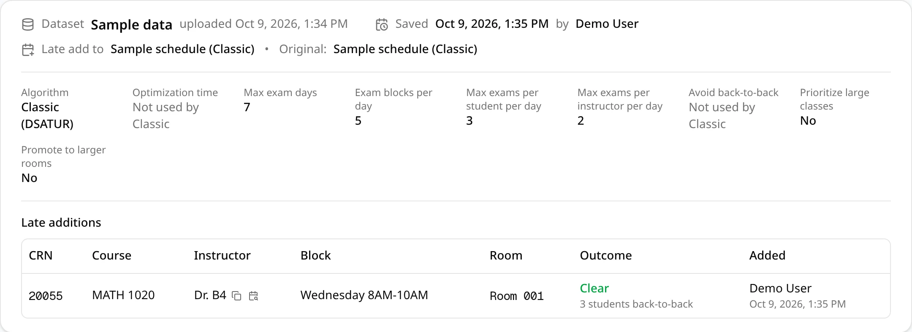

Sometimes a section turns up after you generated the schedule: its students are in the enrollments
file, but the courses file didn't schedule it, so it has no exam. **Late Add** finds a block and a
free room for that one exam in the schedule you already have. No scheduled exam moves and no room
assignment changes. Saving creates a new schedule; the schedule you started from is never changed.

## When you can use it

- **You can open the schedule.** **Late Add** is on the schedule page, next to **Validate
  Schedule**, for the schedule's owner and for everyone it is
  [shared with](/docs/working-with-others/sharing). The new schedule you save is yours, and it is
  shared with everyone else who has this schedule's versions.
- **It's the newest version.** Late adds build one chain of versions, never branches. If a
  version was already saved from this schedule, **Late Add** opens an amber box that links to it
  instead of the search: open the newer version and use **Late Add** there.

  

- **The dataset still exists.** Late Add reads the dataset's uploaded enrollments and room
  blockouts files. If the dataset was deleted, the button is grayed out, and hovering over it
  explains why.
- **The CRN is in the enrollments file but not in the schedule.** A CRN that the courses file
  lists with students was already scheduled by generation, so Late Add turns it down. A courses
  file row with an enrollment of 0 is accepted: generation skipped it, and the results say so in a
  note.

## Try it with the sample files

The [Quickstart](/docs/start/quickstart) sample enrollments file has one such section: CRN `20055`
is in `enrollments.csv`, with 25 students, but not in `courses.csv`. Open a schedule generated
from the sample files and enter:

| Field | Value |
| --- | --- |
| **CRN** | `20055` |
| **Course code** | `MATH 1020` |
| **Instructor ID** | `Dr. B4` |

This CRN is also why **Validate Schedule** on the sample schedules warns about enrollment rows for
a CRN that isn't in the courses file. A schedule saved with the late add records the CRN, so that
warning goes away there.

## Find blocks

Click **Late Add**, fill in the three fields and click **Find blocks** (it stays grayed out until
all three have text).

| Field | What to enter |
| --- | --- |
| **CRN** | The section's CRN, as the enrollments file writes it. |
| **Course code** | The section's course code. It labels the exam and finds the course's other sections. |
| **Instructor ID** | The instructor exactly as the courses file's instructor column writes them. It is used to check the instructor's conflicts. |

The exam's size is the number of different students the enrollments file lists for the CRN.

ExamEngine then tries every block of the schedule: every exam block of every exam day, as set when
the schedule was generated. In each block it looks for rooms that no exam uses then, that aren't
blocked out, and that seat the exam. If your rooms file marks a large-only room, the same rule as
in generation applies: only an exam too big for every other room may use it, and such an exam may
use no other room. It also counts the conflicts the exam would cause there, using the schedule's
limits on exams per student and per instructor per day.

If the CRN can't be added, a red message under the fields says why: it is already in this schedule
(and where), the courses file schedules it, or the enrollments file has no rows for it.

## The three outcomes

| Heading | When | What's listed |
| --- | --- | --- |
| **Clear blocks found** (green) | At least one block has a free room that fits and no student or instructor conflict: nobody double-booked and nobody over their daily limit. | Only the clear blocks. They can still have back-to-back exams or a large course in a late block. |
| **No clear block, fewest conflicts first** (amber) | Every block with a free room that fits would double-book someone or put someone over their daily limit. | Every block with a free room that fits. Saving needs your confirmation. |
| **No block has a free room that fits** (red) | No block has a free room big enough. | Each block's largest free room open to this exam, or **no free room**. Nothing can be saved. |

Above the blocks you see the CRN, course code and number of students, how many exams the
instructor has in this schedule, and the course's other sections with their times. If it reads
**No exams for this instructor in this schedule**, check the ID against the courses file: a note
says instructor conflicts can't be checked.

The blocks are numbered best first: fewest students double-booked, then fewest students over their
daily limit, then the instructor double-booked, the instructor over their daily limit, students
with back-to-back exams, the instructor back-to-back, and a large course in a late block. Ties go
to the earlier day and block.

## Reading a block

Each block shows its day and time and a room: the smallest free room that seats the exam, marked
**best fit**. When other free rooms fit too, the room is a dropdown where you can pick another.

Under the room, each kind of conflict the exam would cause there has a line (or **No conflicts**):

| Line | Meaning | Details |
| --- | --- | --- |
| **Student double-book** | Students who already have an exam in this block. | The CRNs they're also in. |
| **Student per-day limit** | Students who would have more exams that day than the schedule's limit. | Their number of exams that day. |
| **Instructor double-book** | The instructor already has an exam in this block. | Those CRNs. |
| **Instructor per-day limit** | The instructor would have more exams that day than the schedule's limit. | Their number of exams that day. |
| **Student back-to-back** | Students with an exam in the block just before or after, the same day. | The blocks they'd sit that day. |
| **Instructor back-to-back** | The same for the instructor. | The blocks they'd have that day. |
| **Large course in a late block** | The exam has 100 or more students and the block is on Thursday or later. | None. |

Sections that sit one combined exam count as one exam for their students, and the rooms of one
common exam count as one exam for their instructor. The added exam always counts as one more.

Click a line (all but the large-course one) to expand it. It lists the people involved, each with a
copy button and a calendar button; with more than one person, **Copy all** copies every ID in the
line. The calendar button opens that person's exams in this schedule, with the proposed exam
dashed and marked **Proposed**.

When there is no clear block, the student and instructor conflict lines are amber.

The first block is chosen when the results appear. To choose another, click its round button or
pick a room in it.

## Save a new version

Under the blocks, a sentence repeats what will be saved: the CRN, block and room.

- **New schedule name**: starts as the schedule's name followed by `+` and the CRN, for example
  `Sample schedule (Classic) + 20055`. Names are at most 50 characters and must differ from your
  other schedules' names.
- **Save with these conflicts**: only when there is no clear block. The checkbox lists the chosen
  block's conflicts; tick it to confirm you accept them. The tick holds for that block only: choose
  another block and you confirm again.
  Back-to-back exams and a large course in a late block never need this tick.

Click **Save as new schedule**. ExamEngine checks the block and room again before saving; if
anything fails, a red message explains it and nothing is saved. Otherwise the new schedule opens.

## The original is never changed

The new schedule is a copy of the one you started from plus the added exam, with the same
settings. Its conflicts are the original's plus the ones the added exam causes. The schedule you
started from keeps every exam, room and conflict it had, and deleting the new version doesn't
affect it.

## Version history

On a late-add version's page, the details at the top read **Saved** (not **Generated**), and a line
shows:

- **Late add to**: the schedule this version was made from.
- **Original**: the generated schedule at the start of the chain.

Either reads **Not available** when that schedule was deleted or isn't shared with you. A **Late
additions** table lists every exam added late along the chain: CRN, course, instructor, block,
room, the outcome (**Clear** or **Least conflicts**) with that block's conflicts, and who added it
when.

In the schedules list, a version's **Algorithm** column shows a **Late add** badge; hover over it
to see which schedule it's based on. In the **Compact** and **List** views, and in the exam lists
that open from the calendar, the added exam carries the same badge.
