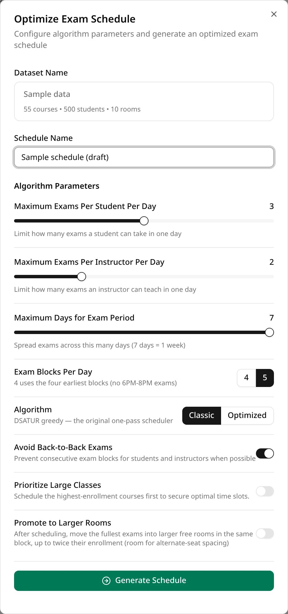
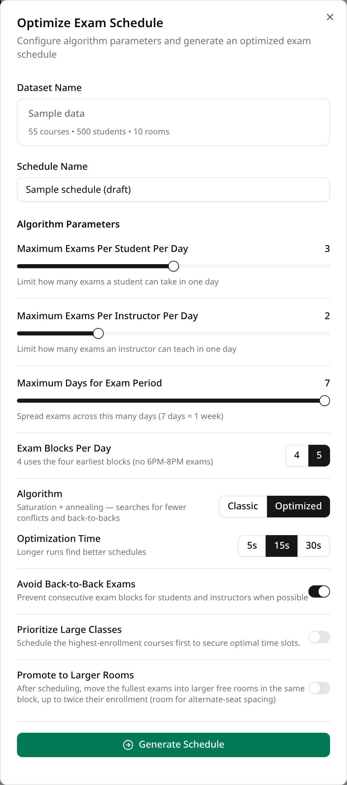
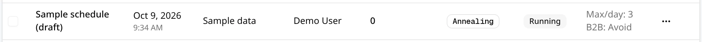
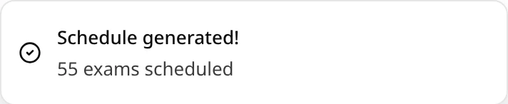

A schedule is always generated from one dataset. Each run makes a new schedule: generating again
never changes a schedule you already have, so you can try different settings on the same dataset
and compare the results.

## 1. Select the dataset

In the **Controls Center** on the left, choose the dataset in the dataset picker. Its size and any
warnings appear under **Current Dataset**. **Generate Schedule** stays disabled until a dataset is
selected.

If the sidebar says some groups or sections **will be unscheduled**, ExamEngine already knows it
can't seat them; see [Why exams end up unscheduled](/docs/generating/unscheduled-exams).

## 2. Open the dialog

Under **Optimization Controls**, click **Generate Schedule**. The **Optimize Exam Schedule** dialog
opens. Its first box, **Dataset Name**, shows the dataset you're about to use, with its number of
courses, students and rooms.

## 3. Name the schedule

Type a name in **Schedule Name**. A name is required, and it must be different from the names of
your other schedules: if you reuse one, generation fails with a message saying the name already
exists.

## 4. Choose the settings

Under **Algorithm Parameters**:

- **Maximum Exams Per Student Per Day** and **Maximum Exams Per Instructor Per Day**: the daily
  limits (1 to 5).
- **Maximum Days for Exam Period**: how many days, starting Monday, the exams may use (1 to 7).
- **Exam Blocks Per Day**: 4 or 5 blocks a day. See
  [Exam days and blocks](/docs/generating/exam-days-and-blocks).
- **Algorithm**: **Classic** or **Optimized**. See
  [Classic vs Optimized](/docs/generating/classic-vs-optimized).
- **Optimization Time** (only with **Optimized**): 5, 15 or 30 seconds.
- **Avoid Back-to-Back Exams**, **Prioritize Large Classes** and **Promote to Larger Rooms**:
  switches. Not every engine uses every switch.

The [Settings reference](/docs/generating/settings) lists every setting, its default and which
engine uses it. If you just want a schedule, the defaults are a good start.

The dialog remembers your settings while you work, also after you close it. Reloading the page
puts them back to the defaults.

## 5. Generate

Click **Generate Schedule** at the bottom of the dialog. While the schedule is being made, the
button reads **Generating...**, the settings can't be changed, and a message in the corner says
which engine is running.

You can close the dialog and keep working: generation goes on. The new schedule is already at the
top of the schedules list, with the status **Running**.

## 6. Find the result

When the schedule is saved, the message changes to **Schedule generated!** and the schedule's
status changes to **Completed**. The **Schedule Name** box is cleared for the next run.

The number in the message counts every exam in the schedule, including exams that couldn't be
scheduled. To see whether any were left out, open the schedule and look at **Needs attention** on
the **Statistics** tab.

Classic usually finishes within a few seconds. Optimized takes about the optimization time you
chose, plus the time to load the dataset and save the result.

Click the schedule's name in the list to open it. The top of the schedule page lists the settings
it was generated with, and the list's **Algorithm** column shows **DSATUR** for Classic and
**Annealing** for Optimized. For what to do next, see
[The schedule page](/docs/reviewing/schedule-page).

## If generation fails

If something goes wrong, the message changes to **Generation failed**, with the reason, and the
schedule disappears from the list. (A run that failed partway can show up again after you reload
the page, with the status **Failed**; you can delete it.) A common reason is a schedule name you
have already used: pick another name and click **Generate Schedule** again.
