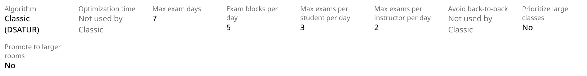
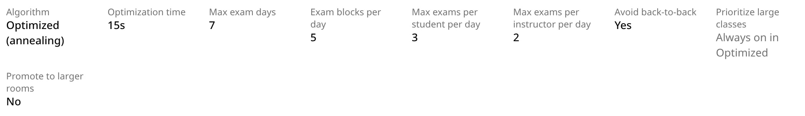

The defaults below are what the **Optimize Exam Schedule** dialog shows when you open it after
loading the page. Every schedule records the settings it was generated with; the schedule page
shows them at the top, under the labels in the second table.

## The settings

| Setting in the dialog | Options | Default | Classic | Optimized |
| --- | --- | --- | --- | --- |
| **Algorithm** | **Classic** or **Optimized** | **Classic** | — | — |
| **Optimization Time** | 5, 15 or 30 seconds; shown only when **Optimized** is selected | 15s | Not used by Classic | How long the optimizer searches |
| **Maximum Exams Per Student Per Day** | 1 to 5 | 3 | Used | Used |
| **Maximum Exams Per Instructor Per Day** | 1 to 5 | 2 | Used | Used |
| **Maximum Days for Exam Period** | 1 to 7 | 7 | Used | Used |
| **Exam Blocks Per Day** | 4 or 5 | 5 | Used | Used |
| **Avoid Back-to-Back Exams** | On or off | On | Not used by Classic | Used |
| **Prioritize Large Classes** | On or off | Off | Used | Always on in Optimized |
| **Promote to Larger Rooms** | On or off | Off | Used | Used |

## What each setting does

**Algorithm** picks the engine. See [Classic vs Optimized](/docs/generating/classic-vs-optimized).

**Optimization Time** is how long Optimized keeps improving the schedule. Longer runs can find
better schedules. Classic runs once and ignores it.

**Maximum Exams Per Student Per Day** and **Maximum Exams Per Instructor Per Day** are daily
limits. Both engines try to keep everyone within them, and treat going over as a hard conflict,
as serious as a double booking. They are not absolute: when there is no other way, an exam is
placed anyway and the people over their limit are listed on the Conflicts tab (**Student Per-Day
Limit**, **Instructor Per-Day Limit**). A lower limit spreads exams out but can leave more
conflicts.

**Maximum Days for Exam Period** and **Exam Blocks Per Day** set the time slots the engines can
use: that many days, starting Monday, each with that many blocks. See
[Exam days and blocks](/docs/generating/exam-days-and-blocks).

**Avoid Back-to-Back Exams** controls whether Optimized tries to avoid exams in consecutive blocks
of the same day, for students and instructors. Turned off, Optimized ignores back-to-backs
completely. Classic ignores the switch: it always tries to avoid back-to-backs, as one of the
tie-breakers it uses when choosing a block.

**Prioritize Large Classes** changes the order in which Classic places exams: on, the largest exams
(by enrollment) go first and get the first pick of time slots; off, Classic orders exams by how
they conflict with each other. Optimized ignores the switch because it always favors large
classes: it tries to keep every exam with 100 or more students on Monday to Wednesday. (Classic
does that too, whichever way the switch is set.)

**Promote to Larger Rooms** moves the fullest exams into larger free rooms after scheduling, for
spaced-out seating. See [Promote to Larger Rooms](/docs/generating/promote-to-larger-rooms).

Classic always places common exams (sections that must sit their exam at the same time) before
everything else, whatever the settings. See
[Combined and common exams](/docs/generating/combined-and-common-exams).

## Settings on the schedule page

The top of each schedule page lists the settings it was generated with. A setting the schedule's
engine doesn't use reads **Not used by Classic**, and **Prioritize large classes** reads **Always
on in Optimized** for an Optimized schedule.

| On the schedule page | In the dialog |
| --- | --- |
| **Algorithm**: Classic (DSATUR) or Optimized (annealing) | **Algorithm** |
| **Optimization time** | **Optimization Time** |
| **Max exam days** | **Maximum Days for Exam Period** |
| **Exam blocks per day** | **Exam Blocks Per Day** |
| **Max exams per student per day** | **Maximum Exams Per Student Per Day** |
| **Max exams per instructor per day** | **Maximum Exams Per Instructor Per Day** |
| **Avoid back-to-back** | **Avoid Back-to-Back Exams** |
| **Prioritize large classes** | **Prioritize Large Classes** |
| **Promote to larger rooms** | **Promote to Larger Rooms** |

Schedules generated before a setting existed can show **Not recorded**. For **Exam blocks per
day**, such schedules show 5 with the note **Not recorded; the only option at the time**, and for
**Promote to larger rooms** they show **No**.
