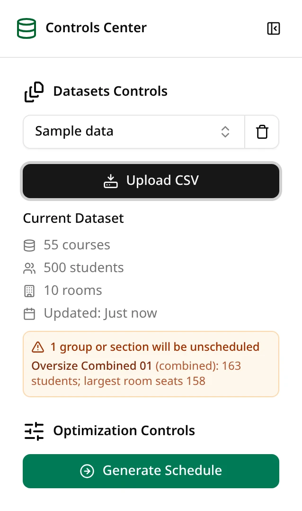
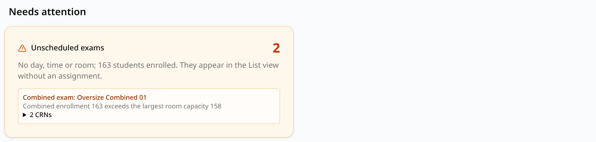

ExamEngine never puts an exam in a room that's too small, never splits a combined or common exam,
and never drops an exam silently. When an exam can't be seated, it stays in the schedule without
a day, time or room, and the schedule tells you why. Conflicts don't cause this: an exam that
would create a conflict is still placed, and the conflict is reported.

## Where you see it

**Before you generate.** When you upload a dataset, ExamEngine checks the sections and groups
against the rooms. Anything that can never be seated shows as a warning during the upload, and
the sidebar keeps listing it under **Current Dataset**, as **N groups or sections will be
unscheduled**, each with its reason.

**On the schedule.** The **Statistics** tab starts with **Needs attention**. Its **Unscheduled
exams** card counts the exams with no day, time or room and the students enrolled in them, then
lists each one with its reason: **Section: CRN** followed by the CRN, or **Combined exam:** or
**Common exam:** followed by the group's name, with its CRNs.

The [List view](/docs/reviewing/list-view) also lists unscheduled exams, marked **Unscheduled**
with their group's name; hover over the mark to see the reason. They are left off the calendar,
and the exported CSV includes them with no day, time or room
([Exporting](/docs/reviewing/exporting)).

## The reasons

The reason text names the actual numbers and rooms. These are the reasons, with the text
ExamEngine shows (numbers and names vary).

| Reason shown | What it means | Known at upload |
| --- | --- | --- |
| `120 students; largest room seats 100` | A section (in no group) has more students than the largest room. | Yes |
| `Combined enrollment 163 exceeds the largest room capacity 158` | A combined exam's sections together don't fit in any one room. | Yes |
| `Contains combined group … with … students, more than the largest room capacity …` | A common exam includes a combined exam that fits no room, so the whole common exam can't be seated. | Yes |
| `Its 4 exams cannot be seated in 4 distinct rooms at the same time` | A common exam needs a separate room for each section (or combined exam) at once, and there aren't enough rooms big enough, even with all of them free. | Yes |
| `No time block has a free, unblocked room large enough for its 85 students` | The exam fits a room, but in every block it could use, the rooms big enough are either taken by other exams or blocked out. | No, only after generating |
| `No time block has 3 free, unblocked rooms large enough for its exams` | The same, for a common exam that needs several rooms at once. | No, only after generating |
| `No rooms are available` | The rooms file has no usable rooms, so nothing can be seated. | No |

### The large-only room

If your rooms file marks one room as large-only, that room is kept for the exams too big for any
other room, and those exams can only go there. The sidebar shows it as **Large-only room**, with
the size above which exams use it. Reasons then mention the rule, for example
`No time block has the large-only room … free and unblocked for its 180 students` (several exams
too big for the other rooms compete for the one large-only room), or a reason ending in
`(only exams over 120 students may use the large-only room …)`.

## What you can change

| Problem | Try |
| --- | --- |
| A section or combined exam is bigger than every room | Add a larger room to the rooms file, or split the combined exam into smaller groups, then upload a new dataset. |
| A common exam can't get enough rooms at once | Check the common exam file (is every section meant to be there?), or add rooms. |
| No block has a free room | Allow more time slots (more days, or 5 blocks per day), remove room blockouts you don't need, or add rooms. Then generate again. |
| Too many large exams for the large-only room | Allow more time slots, or reconsider which room is marked large-only. |

Problems known at upload don't depend on the settings: generating again, with either engine,
leaves the same exams unscheduled until the files change. The "no time block" reasons do depend
on the settings and on the other exams, so another run with more days or blocks, or with the other
engine, can place them.

## Sections that aren't in the schedule at all

A section with an enrollment of 0 in the courses file is left out before scheduling. It isn't
listed as unscheduled; it just isn't in the schedule.
