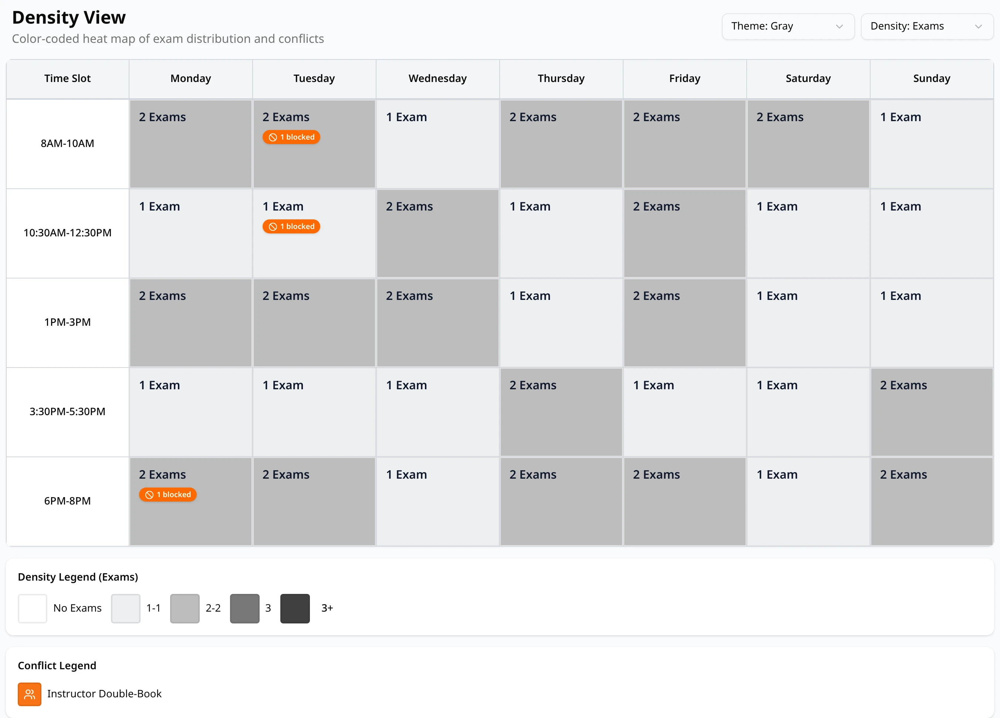
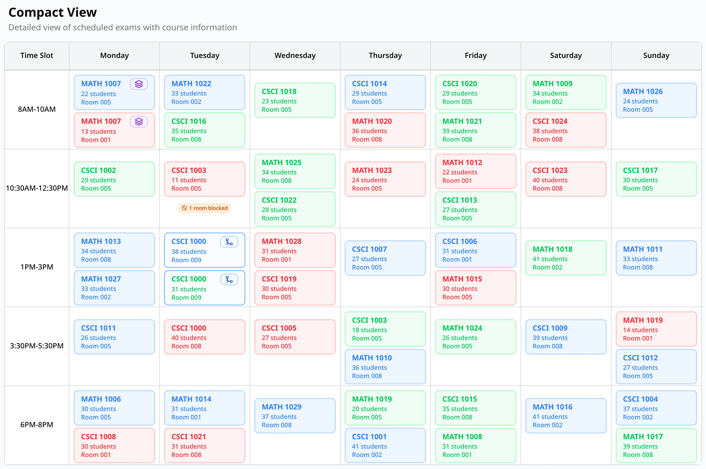
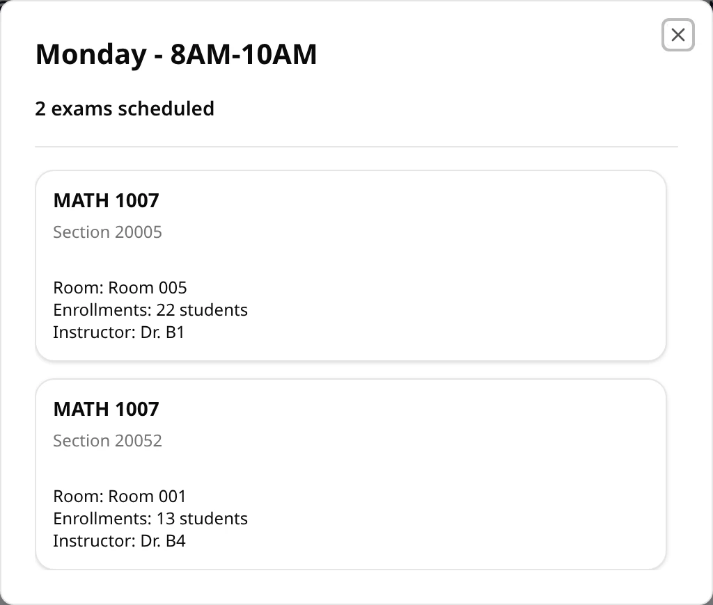

The **Density** and **Compact** tabs show the schedule as a calendar. Both use the same grid: one
row per exam block (the **Time Slot** column gives its time), one column per day from **Monday**
to **Sunday**. Only exams that have a day, a time and a room appear; the others are in the
[List view](/docs/reviewing/list-view).

## Density

**Density** is a heat map: the darker a block, the busier it is. It is the view a schedule opens
on.

Each block shows a count, and **No Exams** when it is empty. Two pickers above the calendar change
what you see:

- **Theme**: the colors, **Gray** (the default), **Blue**, **Green**, **Red**, **Purple** or
  **Sunset**.
- **Density**: what is counted. **Density: Exams** counts the exams in each block; **Density:
  Students** adds up their enrollments, so a block with two exams of 40 students shows 80
  **Students**.

Both go back to their defaults when you reload the page; **Density** also does when you switch
tabs.

### The legend

**Density Legend** below the calendar lists the five shades and the counts each stands for. The
lightest is for empty blocks (labeled **No Exams**, also when you count students). The other four
split the non-empty blocks of this schedule into quarters, from the quietest to the busiest, so the
ranges change from schedule to schedule and between **Exams** and **Students**.

### Badges

A block can carry small badges under its count:

| Badge | Meaning |
| --- | --- |
| **N student** (red) | Double-bookings in this block: someone has two exams at the same time. Instructor double-bookings are counted here too. |
| **N instructor** (amber) | Instructor conflicts in this block: an instructor double-booked, or over the daily limit with an exam in this block. |
| **N blocked** (orange) | Rooms that a room blockout makes unavailable at this time. |

Point at a badge for its meaning. **Conflict Legend**, at the bottom, explains the colors of the
two conflict badges, **Student Double-Book** and **Instructor Double-Book**, or says **No
double-book conflicts detected**. It can list a color that no block shows; the badges on the
blocks are what count. Back-to-back exams and students over the daily limit don't get a badge
here; see them on the [Conflicts](/docs/reviewing/conflicts) tab.

Click a block that has exams to [see its exams](#a-blocks-exams).

## Compact

**Compact** shows the exams themselves: a card per exam in each block.

Each card shows the course, its number of students and its room. Scroll inside a block to see all
its cards. The cards' colors (red, blue or green) are picked at random to tell neighbors apart:
a red card is not a problem. Small icons on a card mark:

| Icon | Meaning |
| --- | --- |
| Blue merge arrows | A combined exam: sections that sit one exam together, in one room. Point at it for **Combined exam**. |
| Violet stacked layers | A common exam: sections that sit their exams at the same time, in separate rooms. Point at it for **Common exam**. |
| **Late add** (amber) | The exam was placed by a [late add](/docs/changing/late-add). |
| Red alert | The exam is part of a conflict: a double-booking, someone over the daily limit, or a large class placed late in the week. Back-to-back exams are not marked. |

See [Combined and common exams](/docs/generating/combined-and-common-exams) for more about the two
kinds of groups.

A block shows at most six cards. When it has more exams, **+N more** at the bottom of the block
opens the [list of all its exams](#a-blocks-exams). A block with rooms blocked at that time also
shows **N rooms blocked**.

## A block's exams

Clicking a block in **Density**, or **+N more** in **Compact**, opens the list of that block's
exams. The title gives the day and the time block, then the number of exams scheduled.

Each exam has a card with:

- the course, with a **Late add** badge if a late add placed it,
- **Section** and its CRN,
- a red badge if the exam is part of a conflict, as in Compact,
- **Room**, **Enrollments** (its number of students) and **Instructor**.

Close the list with **×**, **Esc**, or by clicking outside it.
