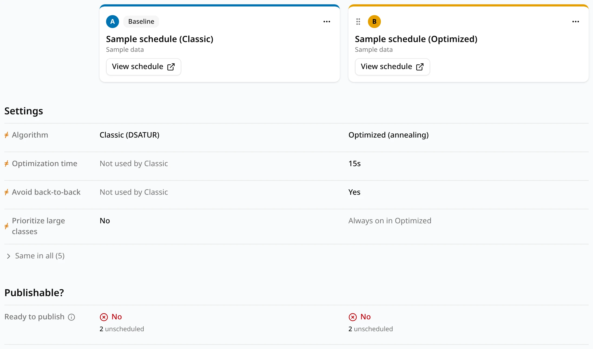
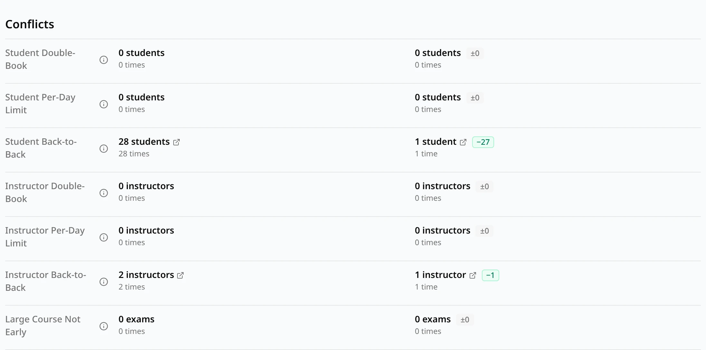
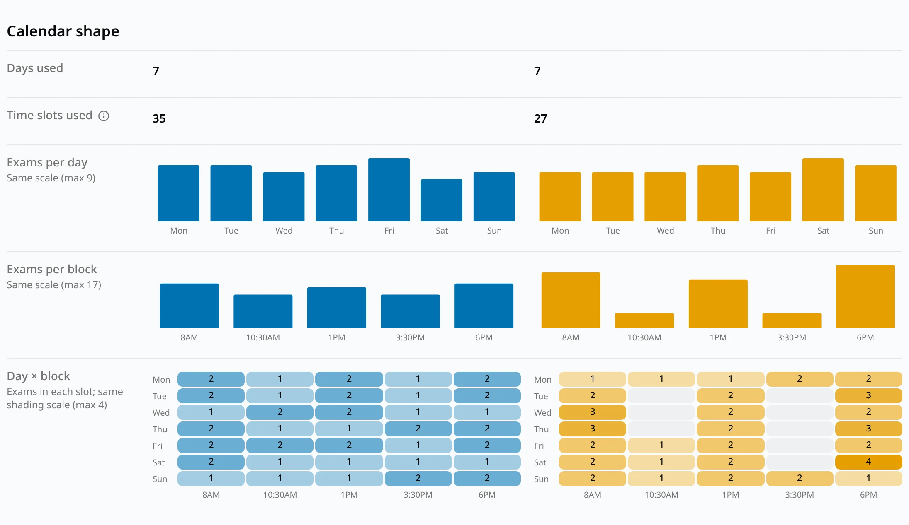
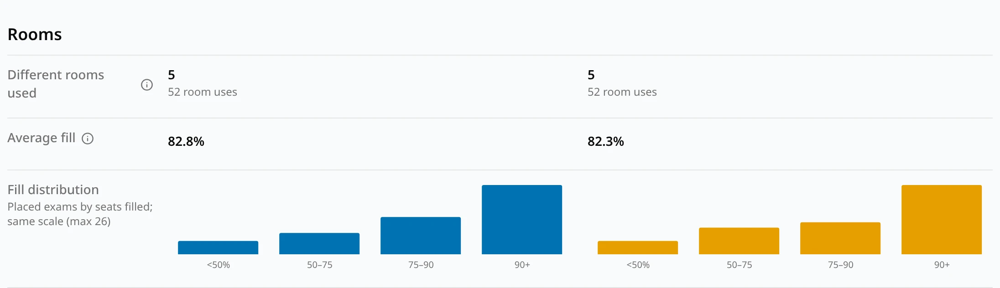
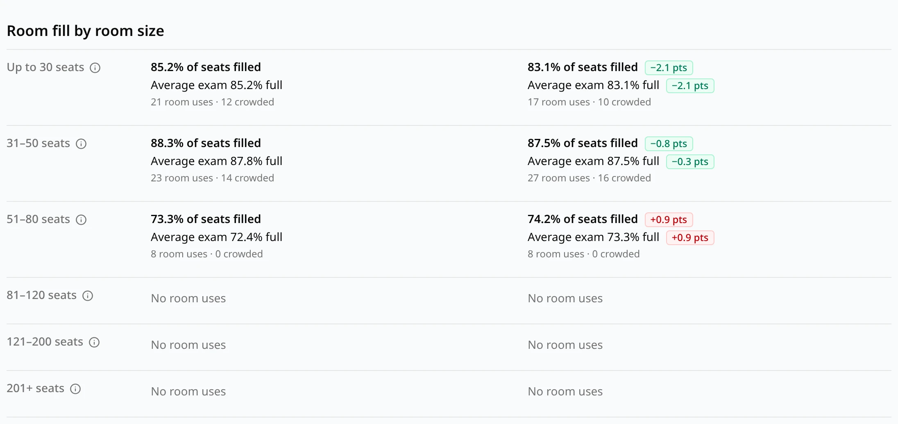

The Compare page shows up to four schedules in columns, so you can see what a different setting or
algorithm changed. A typical use: generate the same dataset with **Classic** and **Optimized**
(see [Classic vs Optimized](/docs/generating/classic-vs-optimized)) and compare the two.

## Choosing schedules

1. On the [schedules list](/docs/reviewing/schedules-list), tick the box at the start of two to four
   rows. Only completed schedules can be ticked, and at most four.
2. Click **Compare** in the bar that appears at the bottom of the page. It is available once two
   schedules are ticked; **Clear** unticks them all.

You can compare your own schedules and those shared with you, from the same or different datasets.

The columns are part of the page address, so a bookmark or a copied link opens the same
comparison. A schedule the person opening the link can't see, or one that was deleted, shows as
**Not available**, with a **Remove** button.

## The baseline

Columns are lettered **A** to **D** and each has its own color, used in its charts. The first
column is the **Baseline**: every other column's numbers are compared with it.

- Next to a count, a green badge such as **−3** means fewer than the baseline (better), a red badge
  such as **+2** means more (worse), and **±0** means the same. For every number on this page, lower
  is better.
- Fill percentages are compared the same way, in percentage points (**pts**): lower fill means
  roomier exams.

## Arranging the columns

Each column's card shows the schedule's name and dataset (marked **(deleted)** if the dataset was
deleted) and a **View schedule** button, which opens the schedule in a new tab.

- **⋯ → Set as baseline** moves that column to the front.
- **⋯ → Move left** and **Move right**, or drag a column by its grip, reorder the other columns. The
  baseline stays first.
- **⋯ → Remove** takes the column off the page.
- **Add schedule**, at the top right while fewer than four columns are shown, searches your
  completed schedules and those shared with you (marked **Shared**) and adds one as the last column.

With fewer than two schedules left, the page asks you to add one, with an **Add schedule** button.

## Settings

The generation settings that differ between the schedules come first, each marked **≠**. The ones
that are the same everywhere are folded under **Same in all**; click it to show them. When all the
schedules used the same settings, the page says so.

A setting the schedule's algorithm doesn't use reads **Not used by Classic**, or **Always on in
Optimized** for **Prioritize large classes**, which Optimized always applies. See
[Settings](/docs/generating/settings).

## Publishable?

**Ready to publish** is **Yes** when a schedule has no hard conflicts (double-bookings or more exams
in a day than allowed) and every exam has a time and a room that fits. Otherwise it is **No**, with
what stands in the way: the number of people with hard conflicts, and the number of exams
unscheduled, without a room or over capacity.

## Conflicts

One row per conflict type, in the same order as the schedule's
[Conflicts](/docs/reviewing/conflicts) tab:

- The first number counts distinct students or instructors (for **Large Course Not Early**, exams),
  with its difference from the baseline.
- The line under it, "N times", counts each occurrence. See
  [How the counts are made](/docs/reviewing/conflicts#how-the-counts-are-made).
- When the first number isn't 0, it is a link: it opens that conflict type in the schedule's
  Conflicts tab, in a new tab.

Click **ⓘ** next to a row's name for the conflict type's definition.

## Calendar shape

How each schedule uses the exam week. The charts in a row share one scale across the columns, so
equal bars mean equal numbers.

| Row | Shows |
| --- | --- |
| **Days used** | Days with at least one exam. |
| **Time slots used** | Different day-and-block slots holding an exam. |
| **Exams per day** | Placed exams on each day, one bar per day. Hover over a bar for the exact number. |
| **Exams per block** | Placed exams in each exam block, labeled by its start time. |
| **Day × block** | A grid of days and blocks, shaded by the number of placed exams in each slot. |

## Rooms

| Row | Shows |
| --- | --- |
| **Different rooms used** | How many different rooms hold an exam at any time in the exam period. Reusing the same rooms block after block lowers it. Under it, **room uses**: one room in one block, summed over all blocks. |
| **Average fill** | The average share of seats filled per placed exam, each capped at 100%. |
| **Fill distribution** | Placed exams by how full their room is: under 50%, 50–75%, 75–90% and 90% or more. Same scale in every column. |

## Room fill by room size

One row per room size: **Up to 30 seats**, **31–50 seats**, **51–80 seats**, **81–120 seats**,
**121–200 seats** and **201+ seats**. The sizes are the same for every schedule and dataset. For
each schedule and size:

- **% of seats filled**: students seated divided by seats, over every room use in rooms of that size.
- **Average exam % full**: the average of each room use's fill, so small exams count as much as large
  ones.
- **Room uses** and how many are **crowded**: at least 90% full.

A room use is one room in one block; the sections of a combined exam sharing it count together.
**No room uses** means the schedule put no exam in a room of that size.

## Schedules from different datasets

When the columns come from more than one dataset, a banner at the top says **These schedules use
different datasets** and names them. Differences can then come from the data as well as from the
settings.
