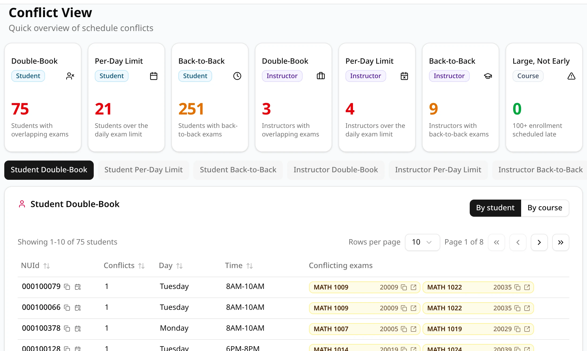
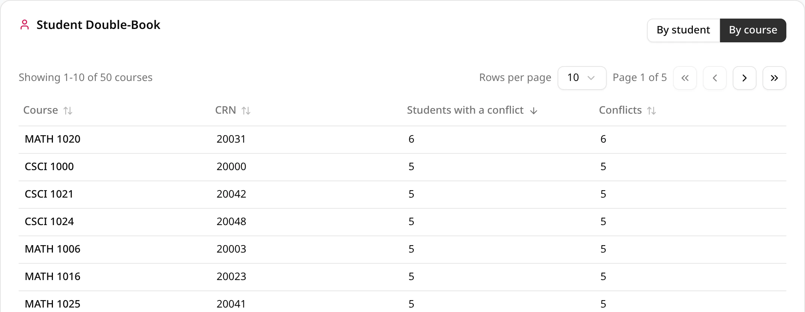
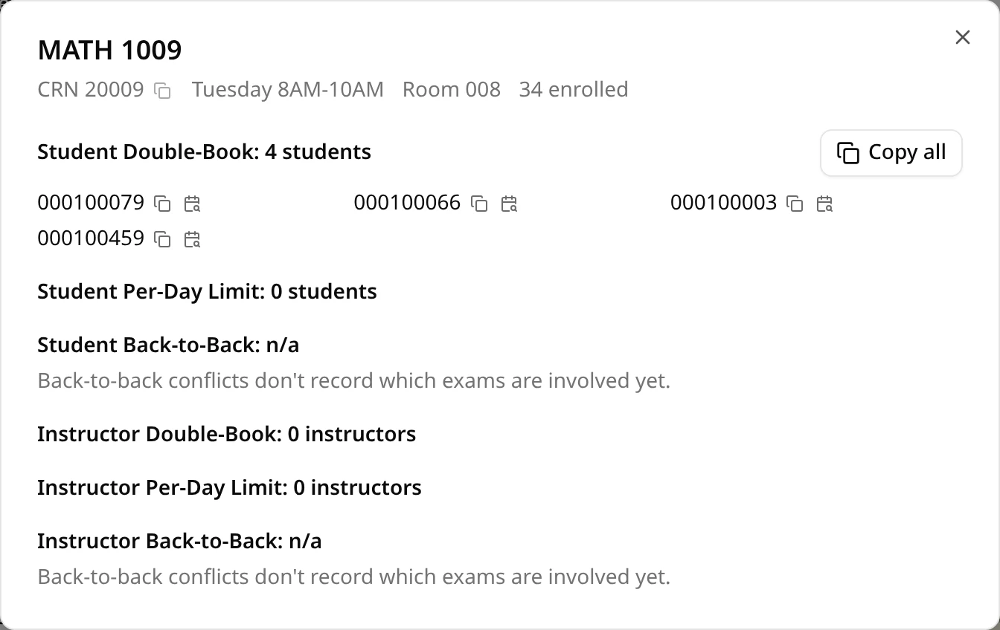
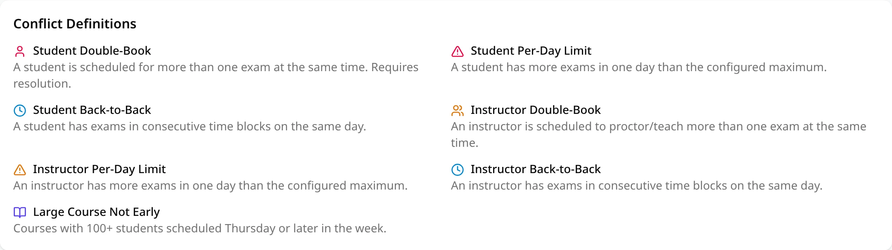

The **Conflicts** tab of a schedule lists every conflict ExamEngine found when it generated the
schedule: students and instructors with two exams at once, too many exams in a day or exams back to
back, and large courses placed late in the week. For what each type means and which ones block
publishing, see [Conflict types](/docs/reference/conflict-types).

## The summary cards

Seven cards across the top give one number per conflict type, in the same order as the tabs below
them. The pill under each title says who the conflict affects: **Student**, **Instructor** or
**Course**.

| Card | Counts |
| --- | --- |
| **Double-Book** (Student) | Students with overlapping exams |
| **Per-Day Limit** (Student) | Students over the daily exam limit |
| **Back-to-Back** (Student) | Students with back-to-back exams |
| **Double-Book** (Instructor) | Instructors with overlapping exams |
| **Per-Day Limit** (Instructor) | Instructors over the daily exam limit |
| **Back-to-Back** (Instructor) | Instructors with back-to-back exams |
| **Large, Not Early** (Course) | Exams of 100 or more students scheduled Thursday or later |

A number is green when it is 0. Otherwise double-books and per-day limits are red, and
back-to-back and large-course numbers are amber. The cards show the same numbers as the
[Statistics](/docs/reviewing/statistics) tab.

## How the counts are made

The cards count **people**, not conflicts: a student with three double-books is one student on the
**Double-Book** card. The **Large, Not Early** card counts exams.

Inside the tables, the **Conflicts** column counts each person's **occurrences**:

- **Double-book**: one per day and time. A student with three exams in the same block has one
  occurrence, listing all three exams.
- **Per-day limit**: one per day the person is over the limit (the column is called
  **Days over limit**).
- **Back-to-back**: one per day with exams in consecutive blocks.

So the number of occurrences can be higher than the number of people. The
[Compare](/docs/reviewing/comparing) page shows both numbers: people first, then "times".

## Conflict-type tabs

Below the cards is one button per conflict type: **Student Double-Book**, **Student Per-Day
Limit**, **Student Back-to-Back**, **Instructor Double-Book**, **Instructor Per-Day Limit**,
**Instructor Back-to-Back** and **Large Course Not Early**. Only the types the schedule has appear.
A schedule without any conflicts shows **Student Back-to-Back** and **Large Course Not Early**, both
empty.

The open type is part of the page address, so a bookmark or a copied link opens the same list.

What a tab lists depends on the type:

| Tab | Columns |
| --- | --- |
| Double-book | **NUId** or **Instructor**, **Conflicts**, **Day**, **Time**, **Conflicting exams** |
| Per-day limit | **NUId** or **Instructor**, **Days over limit**, **Day** |
| Back-to-back | **NUId** or **Instructor**, **Conflicts**, **Day**, **Exam times** |
| Large Course Not Early | **Day**, **Course**, **CRN**, **Size** |

Each student or instructor is one row: their ID and count span one line per occurrence, earliest
first. Next to each ID are a copy button and the
[calendar-search button](/docs/reviewing/explore#the-calendar-search-button), which shows that
person's exams.

- **Per-day limit** rows list only the days a person is over the limit. ExamEngine records just the
  exam that went over the limit, not the person's other exams that day.
- **Back-to-back** rows show the person's exam times that day as gray pills, not the courses:
  ExamEngine doesn't record which exams are involved in a back-to-back conflict yet.

## Conflict pills

On the double-book tabs, each conflicting exam is a yellow pill with its course code and CRN.

- Hover over a pill to see the course, CRN, room and capacity, enrollment and instructor.
- The copy button copies the CRN.
- Click the course name, or the arrow at the end of the pill, to open the
  [course conflict dialog](#the-course-conflict-dialog).

## By student, by instructor or by course

On the student and instructor tabs, the buttons at the top right of the list switch between
**By student** (or **By instructor**) and **By course**. **By course** lists one row per course
instead: **Course**, **CRN**, **Students with a conflict** (or **Instructors with a conflict**) and
**Conflicts**, most people first. Your choice applies to every student and instructor tab until you
switch back.

- Back-to-back tabs can't be shown by course, as they don't record the exams involved.
- On per-day limit tabs, a course counts only for the people whose limit that exam went over.

## The course conflict dialog

Clicking a pill opens a dialog about that course: its CRN (with a copy button), exam day and time,
room and enrollment, then one section per student and instructor conflict type in the schedule.

- Each section names the conflict type and how many students or instructors have that conflict
  with this course, then lists their IDs, each with a copy button and a calendar-search button.
- **Copy all** copies the section's IDs, one per line, ready to paste into an email or a
  spreadsheet.
- Back-to-back sections read **n/a**, for the same reason as above.

Press **Esc** or click **×** to close it.

## Sorting and paging

- Click a column heading to sort by it; click again to reverse the order. **Day** and **Time** both
  sort by each person's earliest conflict. **Conflicting exams** and **Exam times** can't be
  sorted.
- Each tab, and each tab's **By course** list, keeps its own sort while you switch between them.
  Sorting goes back to the first page.
- **Showing 1-10 of …** above and below the list says where you are. Use the arrow
  buttons to go to the first, previous, next or last page.
- **Rows per page** sets 10, 25, 50 or 100 rows for every tab. ExamEngine remembers it until you
  close the browser tab.

## Conflict Definitions

Under the list, **Conflict Definitions** gives a one-line definition of every conflict type, with
the icon its tab uses.

