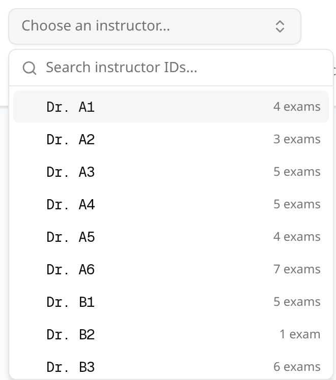
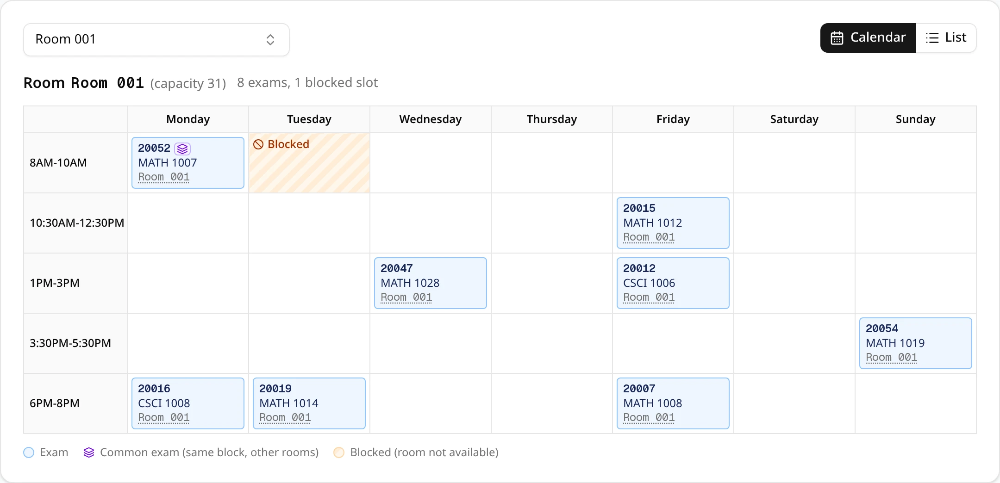
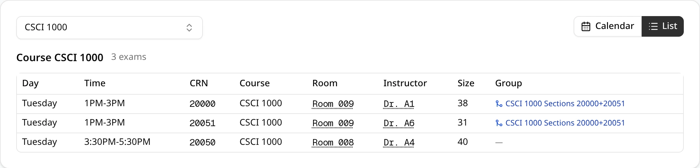
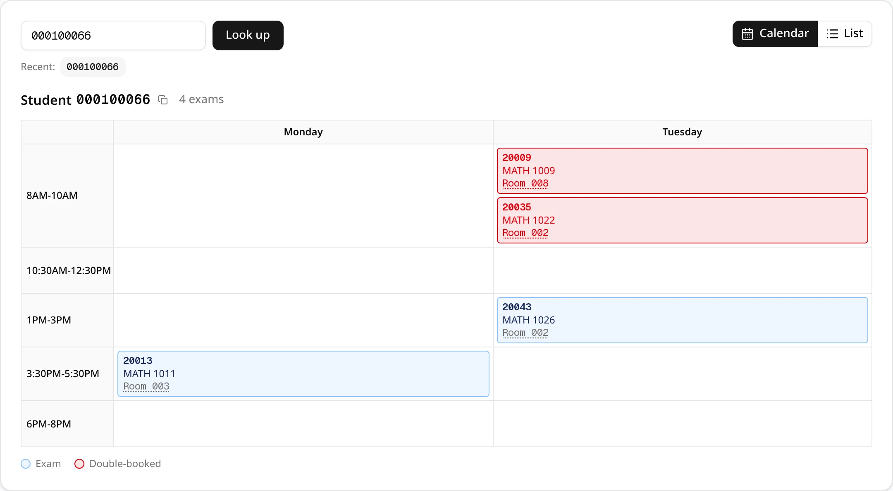
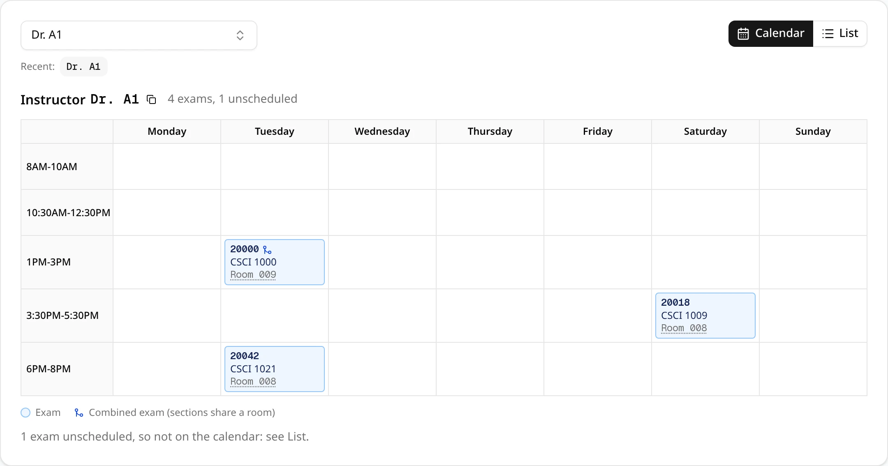
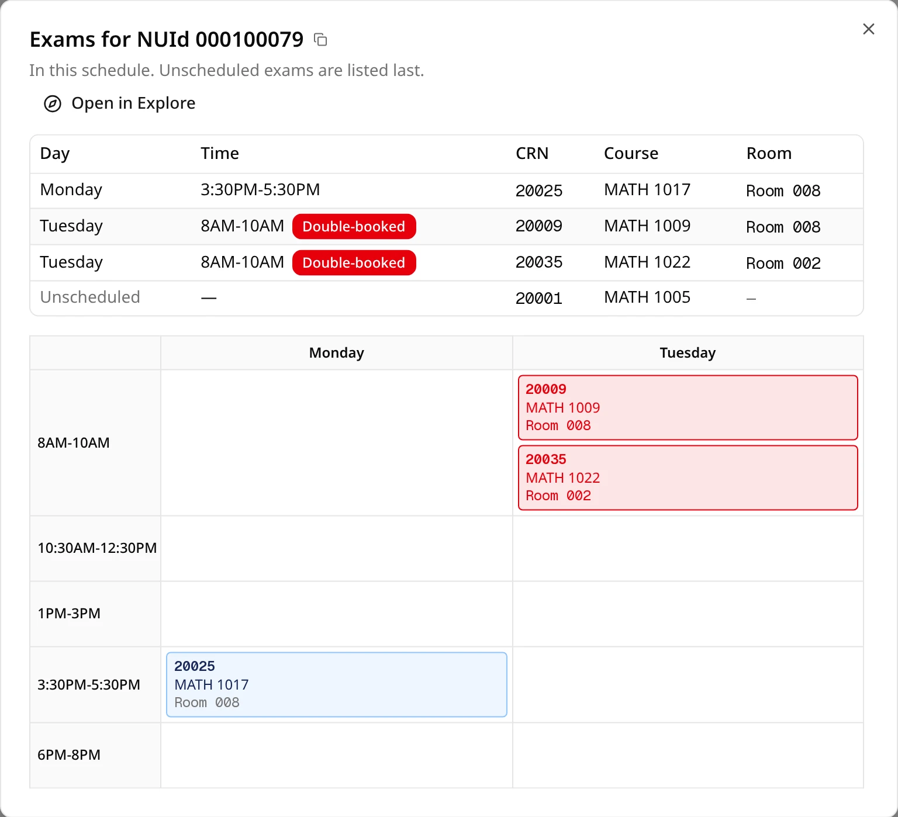

The **Explore** tab of a schedule answers questions such as "when are this student's exams?" or
"what is in this room on Tuesday?". Pick what to look up, choose one, and ExamEngine draws its exams
on the schedule's exam week.

## Choosing what to look up

The buttons at the top pick the kind of lookup: **Room** (the default), **Student**, **Instructor**
or **Course**.

| Lookup | How you choose |
| --- | --- |
| **Room** | Pick from every room in the schedule's dataset. Each room shows its capacity and how many exams it holds. |
| **Student** | Type a student's NUId and click **Look up**. |
| **Instructor** | Pick from the instructors who have an exam in this schedule, each with their number of exams. |
| **Course** | Pick a course code, to see all its sections, or a single CRN. |

The room, instructor and course pickers have a search box: type part of a name, ID or code to
narrow the list. The instructor and course lists show the first 100 matches and say how many more
there are.

A student is found through the dataset's uploaded enrollments file, so you can look up any
enrolled student, whether or not they have a conflict.

## Calendar and List

The **Calendar** and **List** buttons at the top right switch how the results are shown. Above
them, a heading names what you looked up and counts its exams (and, for a room, its blocked slots).

**Calendar** draws the schedule's exam week: days across, exam blocks down, one box per exam with its
CRN, course and room. Click a room to look that room up.

- **Rooms**: slots the room is blocked out (from the room blockouts file) are striped orange and
  marked **Blocked**. An exam inside a blocked slot is red.
- **Students and instructors**: two different exams in the same block are red: the person is
  double-booked.
- **Combined exams** (sections sharing one room): two or more of their sections on the calendar are
  drawn as one framed box listing the sections. A section shown on its own has a blue merge icon
  after its CRN.
- **Common exams** (sections in the same block, in different rooms) have a violet badge. Click it to
  see every section of the common exam and its room.
- Unscheduled exams aren't on the calendar. A line under it says how many there are; they are
  listed in **List**.
- A legend under the calendar explains only the marks it shows.

**List** shows the same exams as a table, unscheduled exams last. It has the columns that make
sense for the lookup, from **Day**, **Time**, **CRN**, **Course**, **Room**, **Instructor**,
**Size** and **Group**. Click an instructor ID or a room to look it up. A room's blocked times are
listed under the table in **Blocked times**, collapsed.

## Students and instructors

- **Recent** lists the last five students (or instructors) you looked up in this schedule. Click one
  to look it up again.
- The copy button next to the heading copies the NUId or instructor ID.

## What stays in the address

The kind of lookup, and the room, course code or CRN you looked up, are part of the page address. A
bookmark or a copied link opens the same lookup, and the browser's **Back** button returns to the
previous one.

Student NUIds and instructor IDs are never put in the address, so they don't end up in your browser
history or in a link you share. ExamEngine keeps them, and the **Recent** lists, in the browser tab
until you close it. Someone who opens a link you copied from a student or instructor lookup sees the
**Student** or **Instructor** lookup with nothing picked.

## Shared schedules

If someone [shared a schedule](/docs/working-with-others/sharing) with you, Explore works the same
as on your own schedules, including rooms' blocked times. You never get the uploaded files
themselves.

Student lookups need the dataset's uploaded enrollments file, so they stop working if the
schedule's dataset is deleted.

## The calendar-search button

A small calendar-with-magnifier button sits next to student NUIds and instructor IDs in other
places too:

- the **Conflicts** tab's lists and the [course conflict dialog](/docs/reviewing/conflicts#the-course-conflict-dialog)
- the **Instructor** column of the [List](/docs/reviewing/list-view) tab
- the **Late additions** table in the details of a schedule made by Late Add
- the people listed in [Late Add](/docs/changing/late-add) results

It isn't shown for a blank ID or a "nan" left by an empty cell in your files. The copy button next to
it copies the ID.

Clicking it opens a popup with that person's exams in the schedule: a short list (unscheduled exams
last), then the exam week. Exams in the same block are red and marked **Double-booked**; sections of
one combined or common exam count as one exam.

- **Open in Explore** switches the schedule to the Explore tab with that student or instructor
  looked up.
- Opened from Late Add results, the popup also draws the exam you are placing at the proposed time,
  dashed and marked **Proposed**. That popup has no **Open in Explore**, because the proposed exam
  is not part of the schedule.
