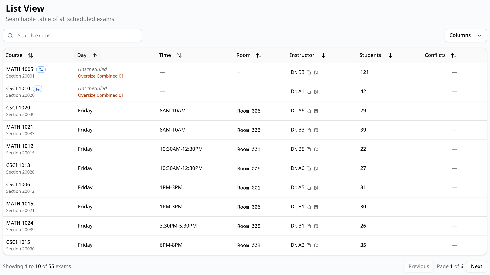

The **List** tab shows every exam (section) in the schedule as a row: the placed ones, and the
ones ExamEngine couldn't give a time or a room. It is the place to look up one exam, or to see
what is missing.

## Columns

| Column | What it shows |
| --- | --- |
| **Course** | The course, with **Section** and the CRN below it. Icons mark a combined exam (blue merge arrows), a common exam (violet stacked layers) and an exam placed by a late add (**Late add**). |
| **Day** | The exam's day, or **Unscheduled**. |
| **Time** | The exam's time block. |
| **Room** | The exam's room, or **No Room**. |
| **Instructor** | The instructor. Next to it, one button copies it and another opens that instructor's exams in this schedule. **TBD** when the course has no instructor. |
| **Students** | The number of students enrolled. |
| **Conflicts** | A red badge if the exam is part of a conflict (a double-booking, someone over the daily limit, or a large class placed late in the week), otherwise **—**. Back-to-back exams are not marked. |

Click a column heading to sort by it; click again to reverse the order. The arrow shows the
current direction. **Day** sorts the day names alphabetically (**Friday** before **Monday**), not
in week order. **Columns** hides or shows columns; as on the schedules list, it lists them by
their internal names, such as `CourseCode` and `StudentCount`.

## Searching

Type in **Search exams...** to keep the exams with that text in their course, CRN, instructor,
room, day, time block or number of students. Case doesn't matter. For example, type a CRN to find
one exam, or a room to see every exam in it.

The table shows 10 exams at a time. **Previous** and **Next** move between pages; the line on the
left shows which exams you are looking at, out of how many.

## Exams without a time or a room

Two kinds of rows stand out:

- **Unscheduled** in the **Day** column: the exam has no day, time or room. ExamEngine couldn't
  seat it anywhere, for example because it has more students than the largest room. If the exam is
  part of a combined or common exam, the group's name appears below **Unscheduled**, in orange.
  Point at the cell to see the reason, such as `Combined enrollment 163 exceeds the largest room
  capacity 158`. **Time** and **Room** show **—**.
- **No Room** in the **Room** column: the exam has a day and a time, but every room large enough
  was blocked at that time by a room blockout. Reducing the blockouts or adding rooms fixes it.

Sorting by **Day** puts the unscheduled exams first, as in the picture. The same exams are listed
under **Needs attention** on the [Statistics](/docs/reviewing/statistics) tab. See
[Unscheduled exams](/docs/generating/unscheduled-exams) for the reasons and what to do about them.
