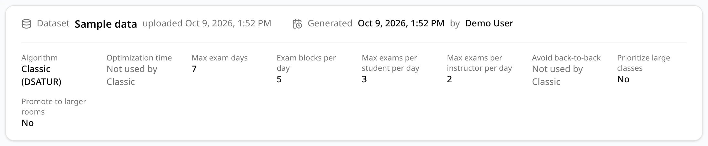

Click a schedule's name in the [schedules list](/docs/reviewing/schedules-list) to open it.
**Back** and the **Schedules** link at the top take you back to the list.

## The details

The box at the top describes where the schedule came from and how it was made.

- **Dataset**: the dataset the schedule was generated from and when it was uploaded. A red
  **Deleted** badge means the dataset has since been deleted.
- **Generated** *date* **by** *name*: when and by whom the schedule was generated. A schedule
  saved by a late add reads **Saved** instead of **Generated**.
- **Shared by** *name*: on a schedule someone shared with you, who shared it.
- **Late add to** *schedule* • **Original:** *schedule*: only on a schedule saved by a late add.
  The first link is the schedule it was saved from, the second the generated schedule at the start
  of the chain. **Not available** stands for a schedule you can't open, for example because it
  was deleted.

### The settings

Below a line, the settings the schedule was generated with. They are described in
[Settings](/docs/generating/settings).

| Setting | What it shows |
| --- | --- |
| **Algorithm** | **Classic (DSATUR)** or **Optimized (annealing)**. See [Classic or Optimized](/docs/generating/classic-vs-optimized). |
| **Optimization time** | How long Optimized searched, in seconds. |
| **Max exam days** | The most days the exams were allowed to use. |
| **Exam blocks per day** | The number of exam blocks in each day. |
| **Max exams per student per day** | The daily limit for students. |
| **Max exams per instructor per day** | The daily limit for instructors. |
| **Avoid back-to-back** | **Yes** or **No**. |
| **Prioritize large classes** | **Yes** or **No**. |
| **Promote to larger rooms** | **Yes** or **No**. See [Promote to larger rooms](/docs/generating/promote-to-larger-rooms). |

Some values are not a setting's value but explain why there isn't one:

- **Not used by Classic**: Classic ignores the setting. This is the case for **Optimization time**
  and **Avoid back-to-back** on Classic schedules.
- **Always on in Optimized**: Optimized always favors placing large classes early, whatever the
  setting. This is the case for **Prioritize large classes** on Optimized schedules.
- **Not recorded**: the schedule was generated before ExamEngine recorded that setting.
- **Not recorded; the only option at the time**, under **Exam blocks per day**: the schedule was
  generated when every exam day had 5 blocks, before the number was a setting.

### Late additions

A schedule saved by a late add also lists, at the bottom of the box, every exam that late adds
placed in it, including those of earlier versions it was saved from:

| Column | What it shows |
| --- | --- |
| **CRN**, **Course**, **Instructor** | The exam that was added. Next to the instructor ID, a button copies it and another shows that instructor's exams in this schedule. |
| **Block** | The day and time block the exam was given. |
| **Room** | The room it was given. |
| **Outcome** | **Clear** if the exam caused no conflicts, otherwise **Least conflicts** and the conflicts it caused, for example `2 students back-to-back`. |
| **Added** | Who added the exam, and when. |

See [Late add](/docs/changing/late-add) for how late adds work.

## The views

Below the details, a row of tabs switches between six views of the schedule.

| Tab | What it shows | Page address |
| --- | --- | --- |
| **Density** | A calendar colored by how many exams or students each block has. See [Calendar views](/docs/reviewing/calendar-views#density). | `/dashboard/<id>` |
| **Compact** | A calendar with a card for each exam. See [Calendar views](/docs/reviewing/calendar-views#compact). | `?view=compact` |
| **List** | Every exam in a searchable table, including those without a time or room. See [List view](/docs/reviewing/list-view). | `?view=list` |
| **Statistics** | What needs attention, and figures about the schedule. See [Statistics](/docs/reviewing/statistics). | `?view=statistics` |
| **Conflicts** | Every conflict, by kind. See [Conflicts](/docs/reviewing/conflicts). | `?view=conflicts` |
| **Explore** | One room, student, instructor or course and its exams. See [Explore](/docs/reviewing/explore). | `?view=explore` |

The open tab is part of the page address, so a bookmark, a shared link or the browser's **Back**
button brings you to the same view. The schedule opens on **Density** when the address names no
view. On **Conflicts** the address also holds the kind of conflict you opened (for example
`?view=conflicts&type=student_double_book`), and on **Explore** the room or course you looked up
(for example `?view=explore&kind=room&q=Room%20001`). Student and instructor IDs are never put in
the address.

## The buttons

The buttons to the right of the tabs act on the whole schedule.

| Button | Who sees it | What it does |
| --- | --- | --- |
| **Share** | The schedule's owner: whoever generated it, or saved it with a late add | Gives other ExamEngine users access to the schedule. See [Sharing](/docs/working-with-others/sharing). |
| **Validate Schedule** | Everyone who can open the schedule | Re-checks the saved schedule against the dataset's uploaded files. Nothing is changed. See [Validating a schedule](/docs/reviewing/validating). |
| **Late Add** | The schedule's owner | Finds a time and room for an exam that missed generation and saves the result as a new schedule. See [Late add](/docs/changing/late-add). |
| **Export Schedule** | Everyone who can open the schedule | Downloads the schedule as a CSV file. See [Exporting](/docs/reviewing/exporting). |

On a schedule shared with you, only **Validate Schedule** and **Export Schedule** appear. When the
schedule's dataset has been deleted, **Late Add** is greyed out: the uploaded files it searches are
gone. Point at it to see that reason.
