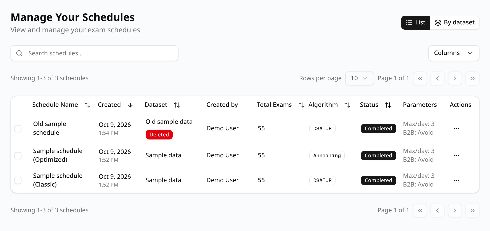
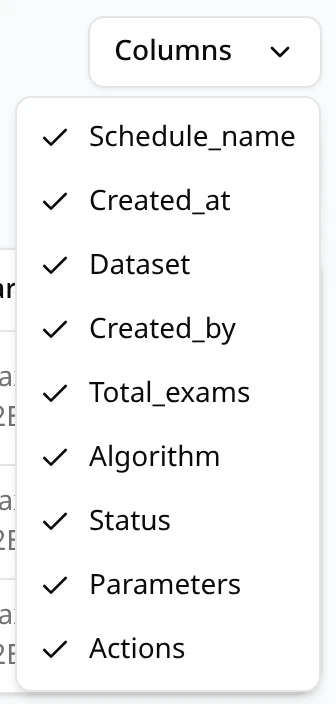
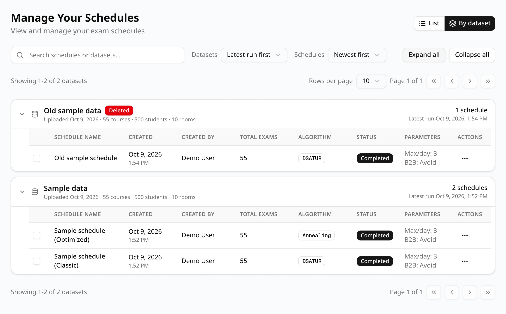
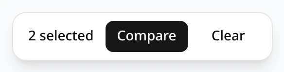
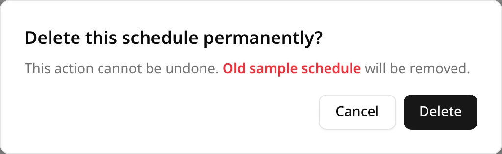

**Manage Your Schedules** is the page you land on after signing in, and the one the ExamEngine
logo takes you back to. It lists the schedules you generated and the ones other users have shared
with you.

Two buttons at the top right switch between two views of the same schedules:

- **List**: one table of every schedule, newest first.
- **By dataset**: one card per dataset, with the schedules made from it inside.

ExamEngine remembers the view, the number of rows per page and the schedules you picked for
Compare until you close the browser.

## The List view

### Columns

| Column | What it shows |
| --- | --- |
| *(checkbox)* | Picks the schedule for Compare. See [Picking schedules to compare](#picking-schedules-to-compare). |
| **Schedule Name** | The name given when the schedule was generated or saved. Click it to open the schedule. |
| **Created** | The date and time the schedule was created. |
| **Dataset** | The dataset the schedule was generated from, with a red **Deleted** badge if that dataset has since been deleted. |
| **Created by** | Who generated the schedule. For a schedule shared with you: **Shared by** the person who shared it, and **Created by** below it. |
| **Total Exams** | The number of exams (sections) in the schedule, placed or not. |
| **Algorithm** | **DSATUR** for a Classic schedule, **Annealing** for an Optimized one, or a **Late add** badge for a schedule saved by a late add. |
| **Status** | **Completed**, **Running** or **Failed**. |
| **Parameters** | Two of the settings: **Max/day** (the most exams a student may have in a day) and **B2B** (**Avoid** or **Allow** back-to-back exams), as chosen when generating. Classic schedules show the choice too, although Classic doesn't use it. **N/A** when the schedule didn't record the setting. |
| **Actions** | The **⋯** menu: **View Schedule** and **Delete**. |

The **Late add** badge marks a version of a schedule that a [late add](/docs/changing/late-add)
saved. Point at it to see which schedule it is based on (**Based on** and the name), or **Based on
a schedule that is not available** if you can't open that schedule, for example because it was
deleted.

### Searching

Type in **Search schedules...** to keep only the schedules with that text in their name, dataset,
algorithm, status or number of exams. Case doesn't matter. The **×** in the box clears the search.

### Sorting

Click a column heading with arrows to sort by it: **Schedule Name**, **Created**, **Dataset**,
**Total Exams**, **Algorithm** or **Status**. The first click sorts in ascending order, the next
one in descending order; the arrow shows the current direction. The list starts sorted by
**Created**, newest first.

### Choosing columns

**Columns** opens a menu with a checkbox for each column. Untick one to hide it, tick it again to
bring it back. The menu lists the columns by their internal names (for example `Schedule_name`
for **Schedule Name** and `Created_at` for **Created**). The checkbox column can't be hidden.

Searching, sorting and hidden columns reset when you leave the page.

### Pages

The bars above and below the table show **Showing 1-10 of** the number of schedules, the **Rows per
page** (10, 25, 50 or 100) and **Page 1 of** the page count, with buttons for the first,
previous, next and last page. A new search or sort goes back to the first page.

## The By dataset view

**By dataset** groups the schedules under the dataset they were generated from. Each dataset card
shows:

- the dataset's name, with a red **Deleted** badge if it has been deleted,
- when it was uploaded and its number of courses, students and rooms,
- how many schedules were made from it, and when the latest one was created (**Latest run**).

Click a card to open or close it. Only the dataset with the most recent schedule starts open;
**Expand all** and **Collapse all** open or close every card. Inside a card, the schedules have the
same columns as in the List view, except **Dataset**.

The controls above the cards work a little differently from the List view:

- **Search schedules or datasets...**: a dataset whose name matches is shown with all its
  schedules; otherwise only the schedules whose name matches are shown, under their dataset.
- **Datasets** sorts the cards: **Latest run first**, **Dataset name A–Z** or **Newest upload
  first**.
- **Schedules** sorts the schedules inside each card: **Newest first**, **Oldest first**, **Name
  A–Z** or **Most exams first**. The column headings don't sort here.
- Pages count datasets, not schedules: **Rows per page** sets how many dataset cards a page shows.

## Schedules from a deleted dataset

Deleting a dataset keeps the schedules made from it. They still open, show their exams and export,
and are marked with a red **Deleted** badge next to the dataset's name, in the list and on the
schedule page. What needs the uploaded files no longer works for them: **Late Add** is
unavailable on such a schedule.

## Picking schedules to compare

Tick the checkbox at the start of a row to pick that schedule for the Compare page. A bar appears
at the bottom of the page with the number of schedules picked, **Compare** and **Clear**.

- Only **Completed** schedules can be picked. The checkbox of a running or failed schedule is
  greyed out; point at it to see why.
- You can pick up to **4** schedules. Once four are picked, the other checkboxes are greyed out
  until you untick one.
- **Compare** needs at least **2** schedules. It opens the Compare page with the picked
  schedules, in the order you picked them.
- **Clear** unticks every schedule.

Your picks stay while you page, search, sort or switch between **List** and **By dataset**. See
[Comparing schedules](/docs/reviewing/comparing) for what the Compare page shows.

## Deleting a schedule

1. Click **⋯** at the end of the schedule's row and choose **Delete**.
2. ExamEngine asks **Delete this schedule permanently?** Click **Delete** to confirm, or
   **Cancel**.

The schedule and its exam assignments are deleted; this can't be undone. Its dataset and any other
schedules are not affected. A schedule that was shared also disappears for the people it was shared
with.
