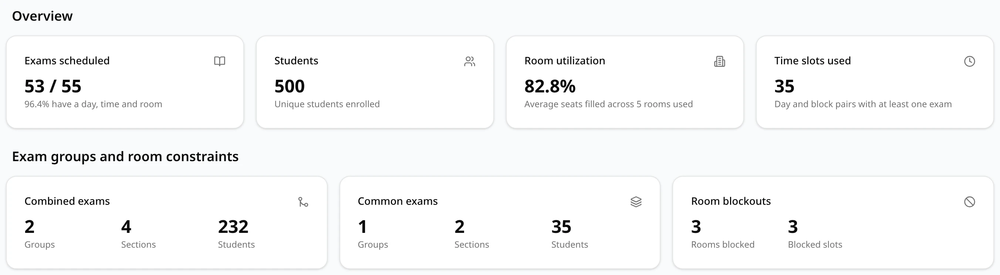
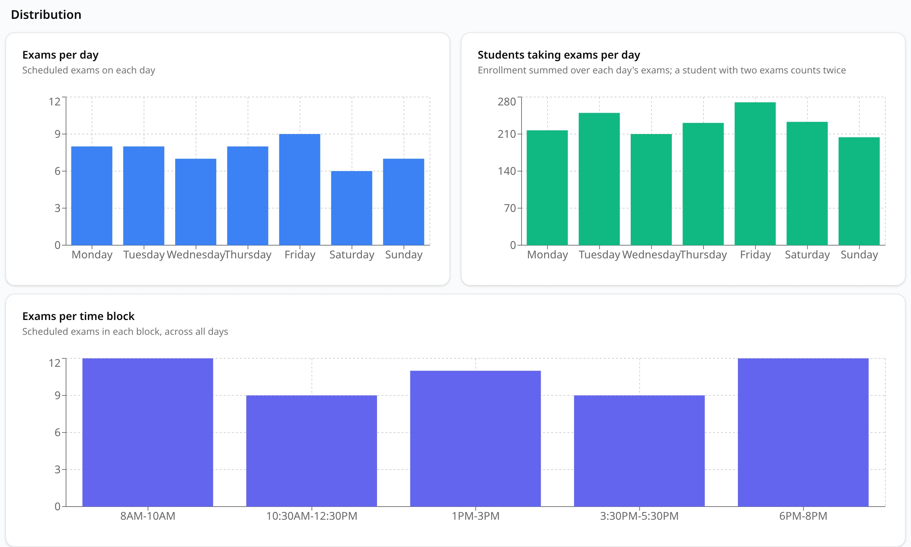

The **Statistics** tab sums up the schedule in four sections, from the most urgent down:
**Needs attention**, **Overview**, **Exam groups and room constraints** and **Distribution**.
Every figure is worked out from the saved schedule, so it stays the same each time you open it.

## Needs attention

This section lists what a person has to deal with before the schedule can be published. Only
problems that exist get a card; when there are none, it says **Every exam has a time and a room
that fits, and there are no hard conflicts.**

| Card | What it counts |
| --- | --- |
| **Hard conflicts** (red) | People with overlapping exams or more exams in a day than allowed: **Students double-booked**, **Instructors double-booked**, **Students over the daily limit** and **Instructors over the daily limit**, each the number of different people, listed only when not zero. **View conflicts** opens the [Conflicts](/docs/reviewing/conflicts) tab. |
| **Unscheduled exams** | Exams with no day, time or room, and the students enrolled in them. Each combined exam, common exam or single section left out has a box with its name (**Section: CRN** and the number for a section) and the reason; a group's **CRNs** line opens to list its sections. Exams without a recorded reason are listed under **CRNs** (or **other CRNs**), with course and size. |
| **Exams without a room** | Exams that have a day and a time, but every room large enough was blocked by a room blockout. Reduce the blockouts or add rooms. |
| **Rooms over capacity** | Exams placed in a room with fewer seats than students. Each line gives the CRN, course, students/seats and the room. |

The number at the top right of a card is the number of exams concerned. The **Hard conflicts**
card has none, because one person can be in more than one of its lines. Back-to-back exams are
soft conflicts and are not listed here; the Conflicts tab counts them.

See [Unscheduled exams](/docs/generating/unscheduled-exams) for why exams are left out and what
to do about it.

## Overview

Four headline figures.

| Card | Meaning |
| --- | --- |
| **Exams scheduled** | Exams with a day, a time and a room, out of all the exams in the schedule, and that share as a percentage. |
| **Students** | Unique students in the dataset's enrollments file. **Dataset details not available** when the upload didn't record it. |
| **Room utilization** | How full the rooms are, on average: for each placed exam, its students divided by its room's seats (counted as 100% when the room is over capacity), averaged over all placed exams. The line below gives the number of different rooms used. |
| **Time slots used** | Day and block pairs with at least one exam. |

## Exam groups and room constraints

One card for each kind of group or room rule that occurs in the dataset; the section is left out
when there are none.

| Card | Figures |
| --- | --- |
| **Combined exams** | **Groups**: combined exams in the dataset. **Sections**: the sections in them. **Students**: their enrollments added up. |
| **Common exams** | The same for common exams. A combined exam with a section in a common exam counts as part of the common exam. |
| **Room blockouts** | **Rooms blocked**: rooms with at least one blockout. **Blocked slots**: the lines in the room blockouts file. |
| **Large-only room:** *room* | Only shown when the rooms file marks a room as large-only. **Exams over** *N*: the time blocks in which this schedule uses the room (sections sharing it in one block count once). **Students**: the students seated there over the exam period. **Seats**: the room's capacity. |

The **Sections** and **Students** of a group count all its sections, also those left unscheduled.

## Distribution

Three bar charts of the placed exams. Point at a bar for its exact value.

- **Exams per day**: the exams scheduled on each day.
- **Students taking exams per day**: the enrollments of each day's exams added up. A student with
  two exams that day counts twice.
- **Exams per time block**: the exams in each block, all days together.

Days and blocks without any exam are left out of the charts.
