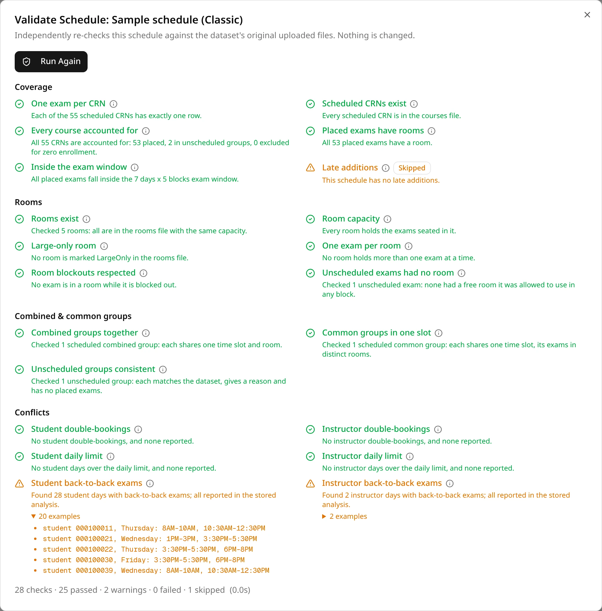

The Schedule Validator re-checks a saved schedule against the files its dataset was uploaded from.
It doesn't trust what ExamEngine stored when it generated the schedule: it recomputes room use,
exam groups and conflicts from the original courses, enrollments and rooms files, and compares.
Run it before you publish a schedule, or whenever you want a second opinion on one.

Validating changes nothing: not the schedule, not its conflicts, not your data.

## Running it

1. Open the schedule and click **Validate Schedule**, in the row of buttons above the schedule.
2. The dialog lists every check, grouped by category, each marked as not run yet.
3. Click **Run Validation**. Each check spins while it runs, then shows its result.

When the run ends, the bottom of the dialog counts the checks and how many passed, gave a warning,
failed or were skipped, and shows how long the run took.

Anyone who can open the schedule can validate it, including users it was
[shared with](/docs/working-with-others/sharing). The results are only shown in the dialog:
**Run Again** replaces them with a fresh run, and closing the dialog clears them. Nothing is saved.

## Reading the results

| Result | Means |
| --- | --- |
| Green check (pass) | The check found nothing wrong. |
| Amber triangle (warning) | Something to look at, but not an error in the schedule. |
| Red cross (fail) | The schedule, or what ExamEngine stored about it, is wrong. |
| Amber triangle and **Skipped** | The check could not run, or doesn't apply. The line under it says why. |

- Each check has a one-line summary of what it found, for example "All 53 placed exams have a room."
- Hover over (or click) the **ⓘ** next to a check's name to see what it verifies.
- A warning or failure can have **examples**: click to expand them. Up to 20 are listed, then
  "and N more".

### Conflicts show up as warnings

The conflict checks recompute every conflict and compare them with the conflicts ExamEngine stored
for the schedule:

- No conflicts of that type, and none stored: pass.
- Conflicts found, and they match the stored ones exactly: **warning**. The schedule has those
  conflicts, and the [Conflicts](/docs/reviewing/conflicts) tab lists them correctly. For example:
  "Found 28 student days with back-to-back exams; all reported in the stored analysis."
- Conflicts the stored analysis missed, or stored conflicts that aren't real: **fail**. The
  examples start with "Missed:" or "Not real:".

So a schedule with back-to-back exams always has amber conflict checks. A failed conflict check
means the Conflicts tab can't be trusted for that schedule.

### Common reasons to skip

- "This schedule has no late additions.": the late additions check only applies to schedules made
  by [Late Add](/docs/changing/late-add).
- "This dataset has no combined exam groups." or "…no common exam groups.": no such file was
  uploaded with the dataset, or it was empty.
- "No room blockout file was uploaded.": the blockouts check has nothing to check against.
- "The dataset's uploaded files are no longer available.": the dataset was deleted. Most checks
  need its files and are skipped; the ones that only use the saved schedule still run.

A check that stops on an unexpected error fails with "Check crashed" and the error's kind. Run it
again, and report it if it keeps happening.

## The sample data

On the schedules made from the [sample files](/docs/start/quickstart), the data checks show one
expected warning: "Enrollments for unknown courses" finds enrollment rows for one CRN that isn't in
the courses file. That CRN is there on purpose, as the exam to place with
[Late Add](/docs/changing/late-add).

## Every check

### Coverage

| Check | Verifies | Fails or warns when |
| --- | --- | --- |
| **One exam per CRN** | No CRN appears more than once in the schedule. | Fails: a CRN has more than one row. |
| **Scheduled CRNs exist** | Every CRN in the schedule is in the courses file, or is a late addition. | Fails: a scheduled CRN isn't in the courses file. |
| **Every course accounted for** | Every course in the courses file, and every late addition, is placed, unscheduled with a stated reason, or left out for zero enrollment. | Fails: a course is missing from the schedule, or unscheduled without a reason. |
| **Placed exams have rooms** | Every exam with a time also has a room. | Warns: an exam has a time but no room. |
| **Inside the exam window** | Every exam falls within the schedule's days and blocks per day. | Fails: an exam is outside them. |
| **Late additions** | Each exam added by Late Add is placed once at its recorded time and room, isn't a scheduled course in the courses file, and its size, course code and instructor match its enrollments and its stored course. | Fails on any mismatch. Skipped when the schedule has no late additions. |

### Rooms

| Check | Verifies | Fails or warns when |
| --- | --- | --- |
| **Rooms exist** | Every room used is in the rooms file, with the same capacity. | Fails: a room is missing, or its capacity differs. |
| **Room capacity** | No room seats more students than its capacity at any time. | Fails: a room is over capacity in some block. |
| **Large-only room** | The room marked LargeOnly in the rooms file holds only exams too large for every other room, and those exams are seated nowhere else. | Fails on an exam on the wrong side of that rule. Passes when no room is marked. |
| **One exam per room** | No room holds two different exams at the same time. A combined exam counts as one. | Fails: a room holds two exams in one block. |
| **Room blockouts respected** | No exam is in a room during one of its blocked-out times. | Fails: an exam is in a blocked slot. Skipped without a blockouts file. |
| **Unscheduled exams had no room** | No unscheduled section or combined exam (outside common exams) had a free, unblocked room large enough in any block of the exam window. | Warns: a free room could have seated an unscheduled exam. |

### Combined & common groups

| Check | Verifies | Fails or warns when |
| --- | --- | --- |
| **Combined groups together** | All sections of a combined exam share one time and one room. | Fails: a combined exam is split. Skipped when the dataset has no combined exams. |
| **Common groups in one slot** | All sections of a common exam share one time, each in its own room. | Fails: a common exam is split across times, or two of its sections share a room. Skipped when the dataset has no common exams. |
| **Unscheduled groups consistent** | The groups and sections listed as unscheduled match the dataset, give a reason and have no placed exams. A section is listed on its own only if it is in no group. | Fails on any mismatch. |

### Conflicts

Each check recomputes one conflict type from the files and compares it with the stored conflicts
(see [Conflicts show up as warnings](#conflicts-show-up-as-warnings)).

| Check | Recomputes |
| --- | --- |
| **Student double-bookings** | Students with two exams at the same time, from the enrollments file. |
| **Instructor double-bookings** | Instructors with two exams at the same time. |
| **Student daily limit** | Students with more exams in a day than the schedule's setting allows. |
| **Instructor daily limit** | Instructors with more exams in a day than the schedule's setting allows. |
| **Student back-to-back exams** | Students with exams in consecutive blocks of a day. |
| **Instructor back-to-back exams** | Instructors with exams in consecutive blocks of a day. |
| **Large courses late in the week** | Courses of 100 or more students placed Thursday or later. |

### Data consistency

| Check | Verifies | Fails or warns when |
| --- | --- | --- |
| **Stored courses match the file** | Each scheduled course's stored enrollment and instructor match the courses file (or the late addition, for an exam added late). | Fails on a difference. |
| **Stored statistics** | The stored statistics (conflict counts and totals, classes, rooms and time slots used) agree with the stored conflicts and the schedule. | Fails on a difference. |
| **Enrollment totals** | Each course's enrollment in the courses file (a late addition's recorded size) equals the number of students enrolled in it. | Warns: the numbers differ. |
| **Enrollments for unknown courses** | Every enrollment row is for a CRN in the courses file, or a late addition. | Warns: enrollment rows name other CRNs. |
| **Duplicate rows** | No CRN is repeated in the courses file, and no student is enrolled in the same CRN twice. | Warns on a repeat. |
| **Large-only room marks** | The rooms file marks at most one room LargeOnly, that room seats more than every other room, and no room is marked on some rows only. | Fails on more than one mark or a mark on a room that isn't the largest; warns on a room marked on some rows only. |
