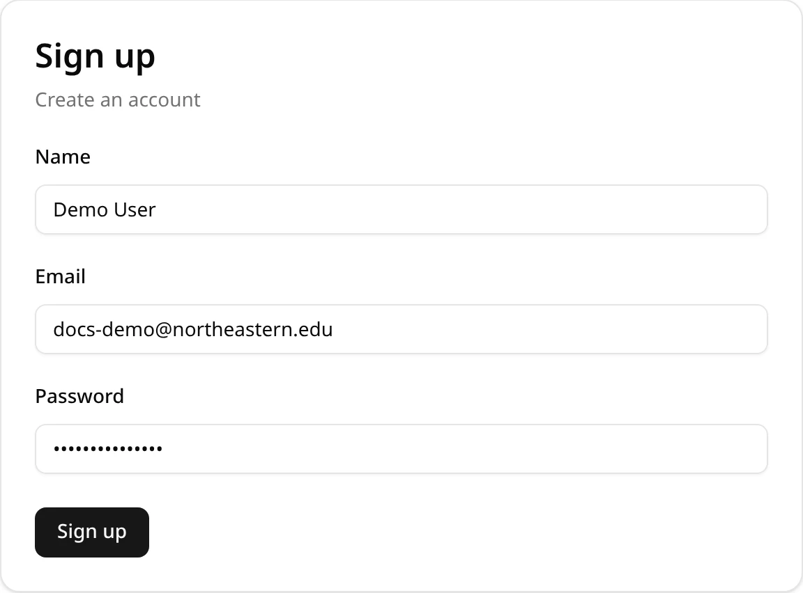
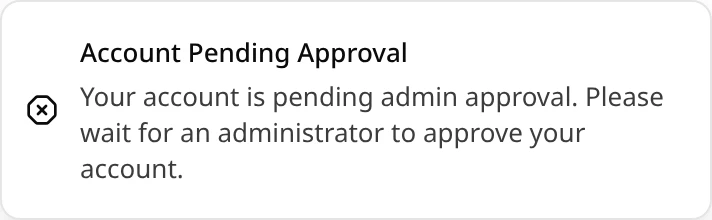
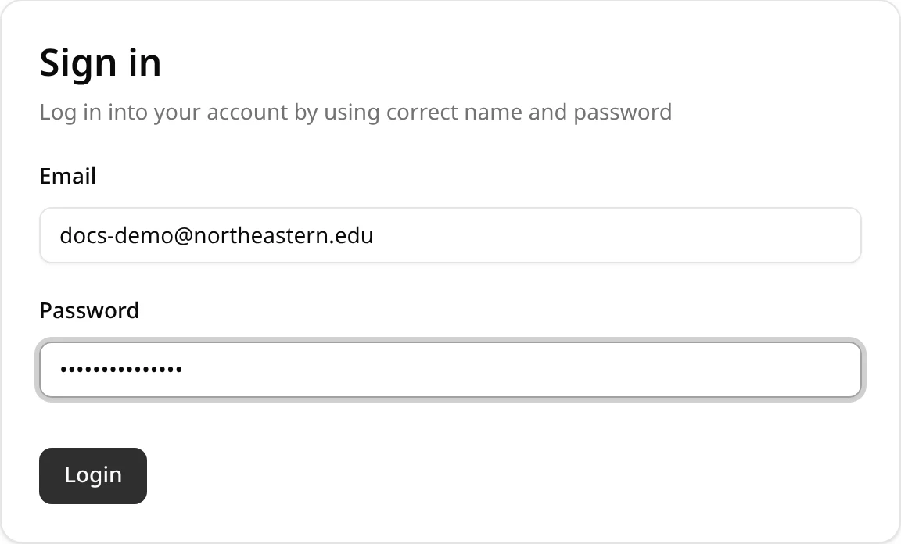
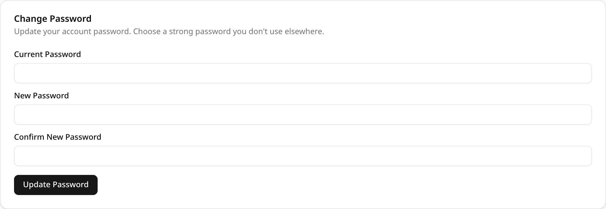

## Signing up

On the sign-in page, choose the **Sign up** tab and enter your name, your email address and a
password, then click **Sign up**.

- Only `@northeastern.edu` email addresses can sign up.
- Each email address can have one account.

A **Sign Up Successful** message confirms that your account was created and is waiting for
approval.

## Waiting for approval

Every new account starts as pending. An ExamEngine administrator approves it, or rejects it, before
it can be used. Until then, signing in shows a message instead of opening the app:

- **Account Pending Approval**: an administrator hasn't approved the account yet. Try again later.
- **Account Rejected**: the account was turned down. Contact an administrator.

## Signing in

Choose the **Sign in** tab, enter your email and password, and click **Login**. You land on the
schedules list.

If the email or password is wrong, a **Login Failed** message says so. When you are signed out,
opening any page of the app brings you back to the sign-in page.

## Changing your password

Open **Settings**, with the gear icon at the top right or **Settings** in the menu under your name.
On the **Account** tab, fill in **Change Password**:

1. **Current Password**: the password you sign in with now.
2. **New Password**: at least 8 characters, with at least one number and at least one character
   that is neither a letter nor a number (for example `!`, `#` or `-`).
3. **Confirm New Password**: the new password again.

Click **Update Password**. A message confirms the change; use the new password from your next
sign-in. ExamEngine has no self-service password reset, so keep your password somewhere safe.

## Signing out

Click your name at the top right and choose **Logout**. You return to the sign-in page.

