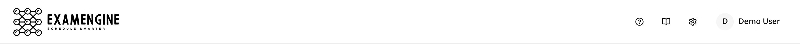
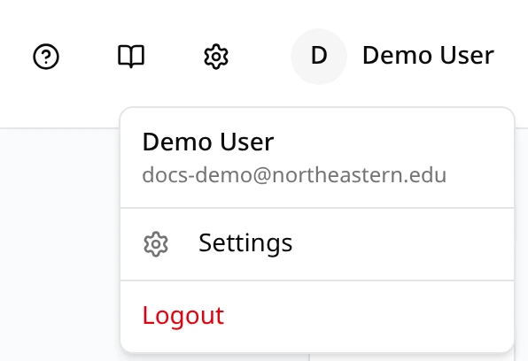
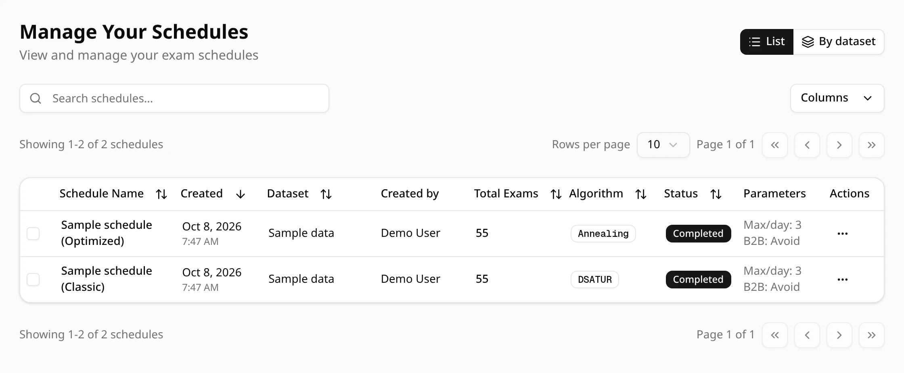
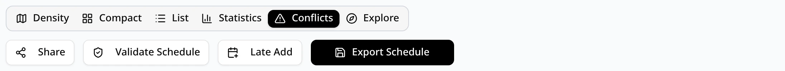
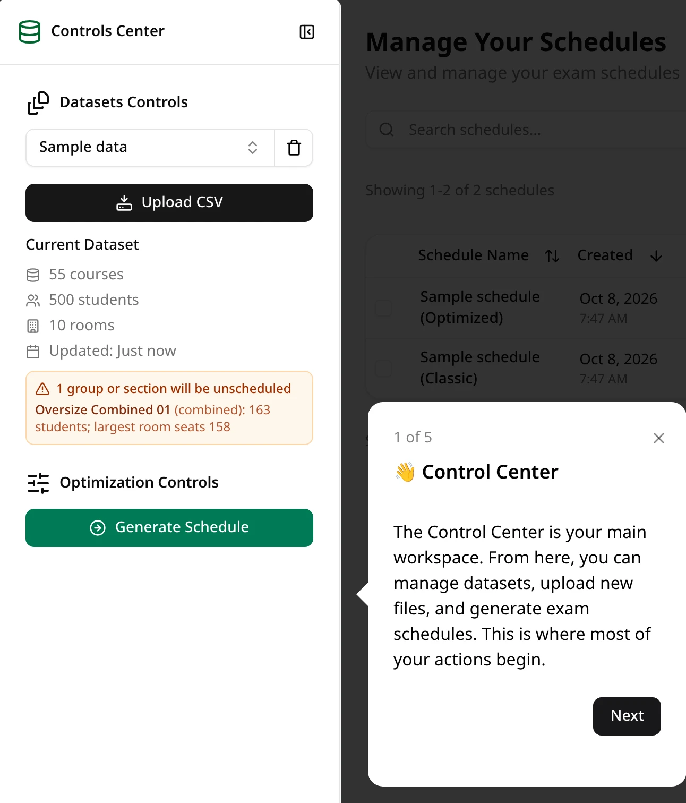

After you sign in, every page has the same frame: a header across the top and the **Controls
Center** on the left. The rest of the window shows the schedules list, a schedule, or Settings.

## The header

- **ExamEngine logo**: back to the schedules list from anywhere.
- **?**: starts the [guided tour](#the-guided-tour).
- **Book**: opens this documentation.
- **Gear**: opens **Settings**, where you can [change your password](/docs/start/accounts#changing-your-password).
- **Your name**: a menu with your email address, **Settings** and **Logout**.

## The Controls Center

The sidebar on the left is where you add data and start new schedules. The button next to its
title collapses it to a narrow strip of icons, and expands it again.

**Datasets Controls**

- **Dataset picker**: shows the selected dataset, or **Choose Dataset** when none is selected.
  Click it to search your datasets and pick one. ExamEngine remembers your choice.
- **Trash icon**: deletes the selected dataset after you confirm. Schedules made from it are kept,
  marked with the dataset as deleted.
- **Upload CSV**: adds a new dataset from your CSV files. See
  [Uploading a dataset](/docs/your-data/uploading-a-dataset).
- **Current Dataset**: the selected dataset's number of courses, students and rooms, and when it
  was uploaded. A warning box appears when some sections or exam groups are too large for any room
  and will be left unscheduled. See [Managing datasets](/docs/your-data/managing-datasets).

**Optimization Controls**

- **Generate Schedule**: opens the dialog where you name a schedule, choose its settings and
  generate it from the selected dataset. It is available once a dataset is selected.

## The schedules list

**Manage Your Schedules** lists your schedules and the ones other users have shared with you,
newest first.

- **List** and **By dataset** switch between one table and one group per dataset.
- The search box filters the schedules; **Columns** chooses which columns to show; click a column
  heading to sort by it.
- Click a schedule's name to open it. The **⋯** menu at the end of each row has **View Schedule**
  and **Delete**.
- Tick two or more schedules and click **Compare** in the bar that appears to see them side by
  side.

## The schedule page

Opening a schedule shows its details at the top (dataset, who generated it and when, and the
settings used), then a row of tabs and buttons.

- **Tabs**: **Density** and **Compact** (calendar views), **List** (every exam in a table),
  **Statistics**, **Conflicts** and **Explore** (look up one room, student, instructor or course).
  The open tab is part of the page address, so a bookmark or a copied link opens the same view.
- **Share** and **Late Add**: on schedules you generated. Share gives another user access; Late Add
  finds a time and room for an exam that missed generation and saves the result as a new
  schedule, leaving this one unchanged.
- **Validate Schedule**: re-checks the schedule against its uploaded files.
- **Export Schedule**: downloads the schedule as a CSV file.

**Back** and the **Schedules** link at the top return to the schedules list.

## The guided tour

Click **?** in the header, on the schedules list, for a six-step tour of the main controls: the
Control Center, **Upload CSV**, **Generate Schedule**, the schedules list, Settings and the
**Book** icon that opens this documentation. Use **Next** and **Previous** to move through it,
and **×** to close it at any time.

