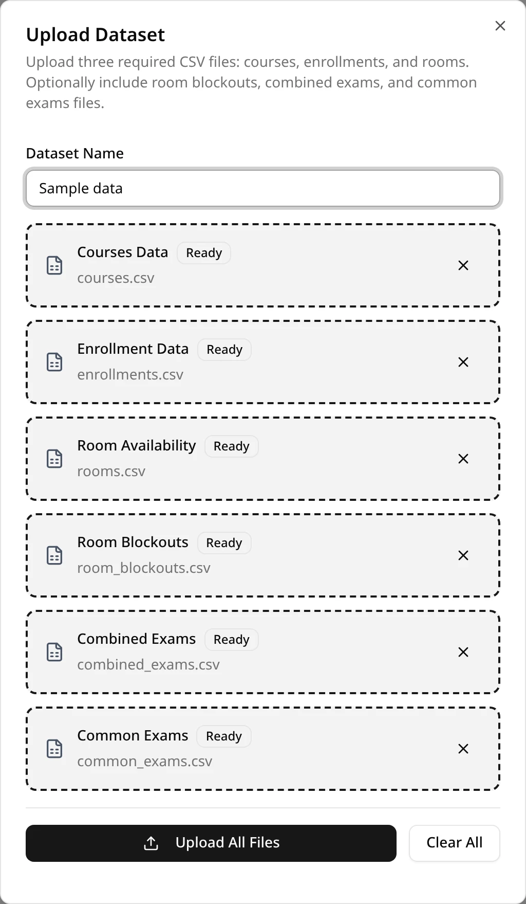
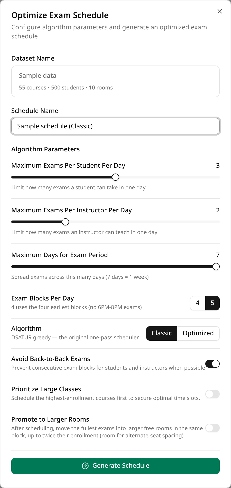
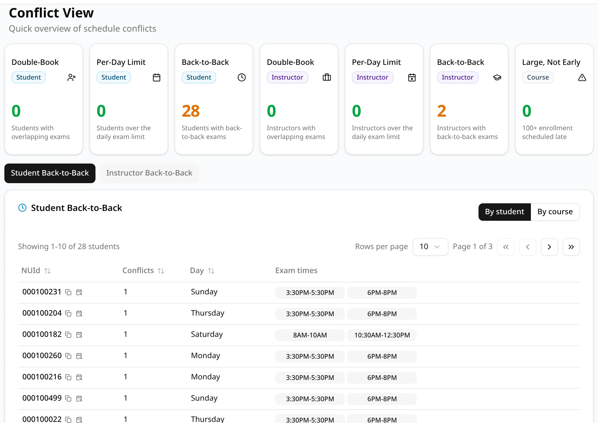

This walk-through uses small sample files with made-up courses, students and rooms, so you can try
every step without your own data. It takes about ten minutes, most of it waiting for your account
to be approved.

## 1. Sign up and wait for approval

Open ExamEngine, choose the **Sign up** tab, and enter your name, your `@northeastern.edu` email
address and a password. Then click **Sign up**.

New accounts start as pending: an administrator has to approve yours before you can sign in. Until
then, signing in shows **Account Pending Approval**.

## 2. Sign in

Once your account is approved, choose the **Sign in** tab, enter your email and password, and click
**Login**. You land on the schedules list. More about accounts in
[Accounts and sign-in](/docs/start/accounts).

## 3. Download the sample files

Save these six files to a folder on your computer. The first three are required for every dataset;
the other three are optional.

| File | What it holds |
| --- | --- |
| <a href="/sample-data/courses.csv" download>courses.csv</a> | 55 course sections: CRN, course, enrollment and instructor |
| <a href="/sample-data/enrollments.csv" download>enrollments.csv</a> | Which of the 500 students is in which section |
| <a href="/sample-data/rooms.csv" download>rooms.csv</a> | 10 rooms and how many people each seats |
| <a href="/sample-data/room_blockouts.csv" download>room_blockouts.csv</a> | Times when a room can't be used |
| <a href="/sample-data/combined_exams.csv" download>combined_exams.csv</a> | Sections that sit one exam together, in one room |
| <a href="/sample-data/common_exams.csv" download>common_exams.csv</a> | Sections that sit their exams at the same time, in separate rooms |

## 4. Upload a dataset

In the **Controls Center** on the left, under **Datasets Controls**, click **Upload CSV**. Give the
dataset a name, for example `Sample data`, then add each file to its box: courses, enrollments and
rooms, then room blockouts, combined exams and common exams. Click **Upload All Files**.

When the upload finishes, close the dialog. The new dataset is selected, and the sidebar shows its
size under **Current Dataset**.

The sample deliberately includes a combined exam, `Oversize Combined 01`, with more students than
the largest room seats. ExamEngine warns about it during the upload and in the sidebar: it can't
seat that exam, so the exam will stay unscheduled. Real datasets can have the same problem, and
this is how you'll find out.

## 5. Generate a schedule with the defaults

Under **Optimization Controls**, click **Generate Schedule**. Enter a schedule name, for example
`Sample schedule (Classic)`, leave every setting as it is (the algorithm is **Classic**), and click
**Generate Schedule** at the bottom.

A message confirms when the schedule is ready, usually within a few seconds. Close the dialog: the
new schedule is at the top of the schedules list.

## 6. Open the schedule and read Needs attention

Click the schedule's name to open it. The schedule opens on its calendar (**Density**). Click the
**Statistics** tab. Its first section, **Needs attention**, lists what a person has to deal with:
hard conflicts, unscheduled exams, exams without a room and rooms over capacity. Only problems that
exist are shown.

With the sample files and the default settings, the only item is the combined exam from step 4:
its two sections (CRNs) have no day, time or room. There are no hard conflicts.

## 7. Look at the Conflicts tab

Click the **Conflicts** tab. The cards at the top count each kind of conflict, for students,
instructors and courses. Below them, one button per kind that occurs opens its list: who is
affected, on which day and at which times. The **Conflict Definitions** at the bottom explain each
kind.

The sample schedule has no double-booked students or instructors, but some students and
instructors have back-to-back exams (exams in consecutive blocks on the same day). Classic avoids
them where it can; Optimized usually leaves fewer.

## 8. Export the schedule

Click **Export Schedule**, next to the tabs. Your browser downloads `schedule_exams.csv`, with one
row per exam: CRN, course, day, start and end time, room, room capacity, number of students, a
**Valid** column (false when the exam is part of a hard conflict) and instructor. Unscheduled
exams are included with no day, time or room.

## Next steps

You now have a complete schedule. From here you can:

- **Try Optimized.** Generate again from the same dataset and choose **Optimized** as the
  algorithm. It takes the optimization time you pick (15 seconds by default) and usually leaves
  fewer back-to-back exams.
- **Compare the two schedules.** In the schedules list, tick both schedules and click **Compare**.
- **Validate a schedule.** On the schedule page, **Validate Schedule** re-checks the saved schedule
  against the uploaded files.
- **Share a schedule.** On the schedule page, **Share** gives another ExamEngine user access to it.
- **Use your own data.** Prepare your term's files with the same columns as the sample files and
  upload them as a new dataset. See [Preparing your files](/docs/your-data/preparing-your-files).
