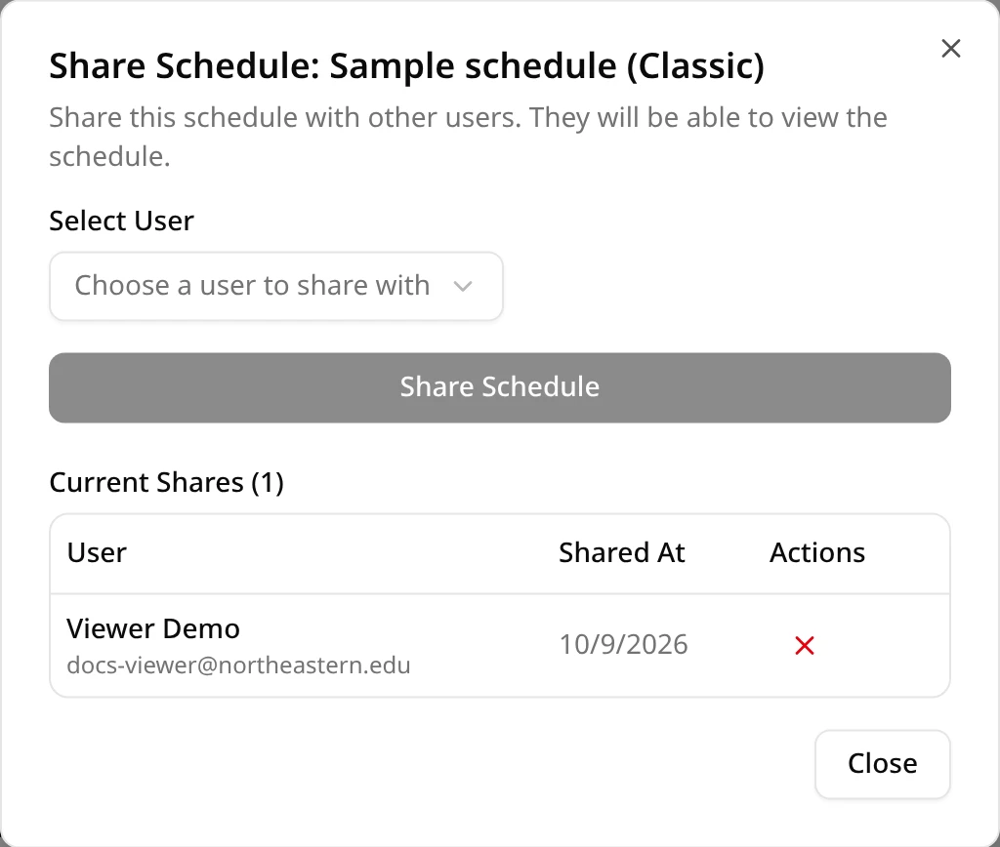
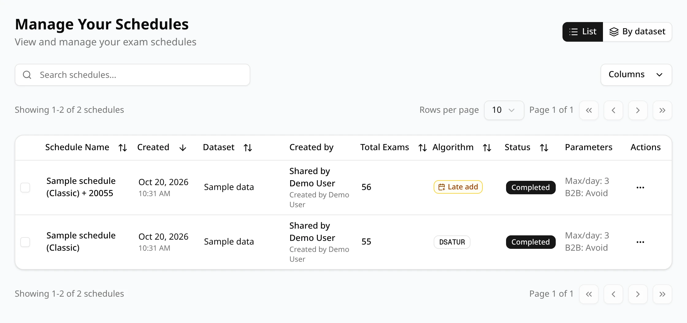
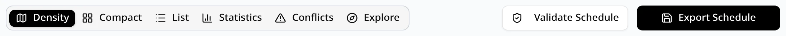

Each schedule belongs to the account that generated it. You can share a schedule with other
ExamEngine users so they can look at it, validate it, export it and add a late exam to it with
[Late Add](/docs/changing/late-add). Nobody you share with can change the schedule itself.

## Share a schedule

Only the schedule's owner can share it. Open the schedule and click **Share**, next to the
schedule's tabs.

1. Under **Select User**, choose a person. The list shows every approved ExamEngine user by name
   and email address, except the people who already have this schedule.
2. Click **Share Schedule**. A message confirms **Schedule shared successfully**, and the person
   appears under **Current Shares**.

- Accounts still waiting for approval aren't in the list.
- The list includes you. Choosing yourself fails with **Cannot share schedule with yourself**.
- A share covers the schedule's whole [Late Add](/docs/changing/late-add) chain: the generated
  schedule it started from and every version saved from it, before and after this one, whoever
  saved them. Other schedules from the same dataset aren't shared until you share them too.

## Manage current shares

The **Share** dialog's **Current Shares** section lists everyone who has the schedule, with their
email address and the date it was shared with them. The red **×** under **Actions** removes that
person's access right away, without asking first; a message confirms **Share removed**. Like
sharing, removing covers the whole chain: the person loses every version they don't own, and they
disappear from their schedules list.

When you delete a schedule, its shares go with it. When you delete the dataset it came from, the
schedule stays shared, with the dataset marked as deleted.

## What the people you share with see

The schedule appears in their schedules list. Its **Created by** column reads **Shared by** and
your name, with the schedule's creator underneath. On the schedule page, the details at the top
show **Shared by** too.

| They can | They can't |
| --- | --- |
| Open every view: **Density**, **Compact**, **List**, **Statistics**, **Conflicts** and **Explore**, including looking up students, instructors, courses and rooms | Share the schedule, or see who else has it |
| **Validate Schedule**, **Export Schedule**, and compare it with other schedules they can open | See your datasets: the dataset isn't in their **Controls Center** |
| **Late Add**, saved as a new schedule of their own | Change the schedule |

On a shared schedule, the buttons next to the tabs are **Validate Schedule**, **Late Add** and
**Export Schedule**: there is no **Share**.

## Late adds by the people you share with

Someone you share a schedule with can use [Late Add](/docs/changing/late-add) on it. Your schedule
doesn't change: their late add is saved as a new schedule that belongs to them, and ExamEngine
shares it with everyone else who has the chain: you and the other people you shared with. It
appears in your schedules list with **Shared by** and their name, and its **Late additions** table
names who added the exam.

Late adds always go on the newest version, so the chain never splits. For example, Bob shares a
schedule with Sam and Jane. Jane adds an exam: her new version is shared with Bob and Sam. To add
another exam, Sam opens Jane's version and uses **Late Add** there; his version is shared with Bob
and Jane. On the older schedules, **Late Add** only links to the newer version.

The owner of any schedule in the chain can share it, which shares the whole chain, including
versions other people saved. Removing someone works the same way. People keep the versions they
saved themselves: those are theirs and are made from your dataset, so they can still open them,
including looking up students in **Explore** and validating them against your uploaded files.

<Callout type="warn" title="Delete removes the schedule for everyone">
In the schedules list, the **Actions** menu of a schedule shared with someone still offers
**Delete**, and it works: it deletes the schedule itself, for its owner too, not only their access
to it. Make sure the people you share with know not to use it. To stop seeing a shared schedule,
ask its owner to remove the share.
</Callout>
