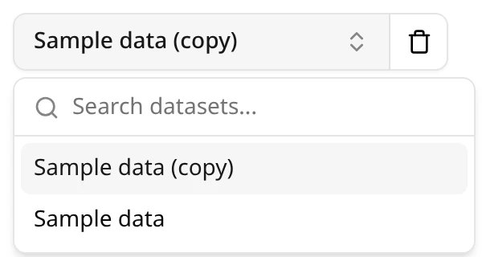
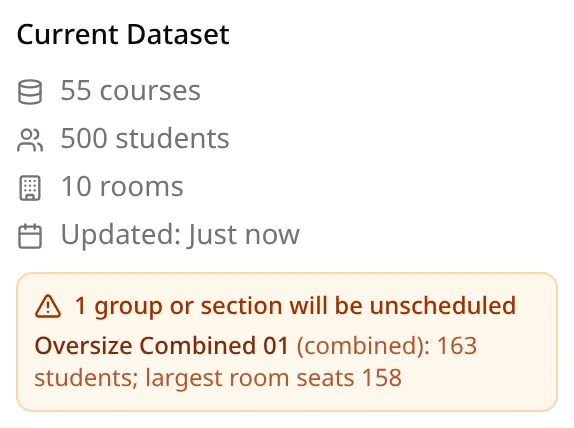
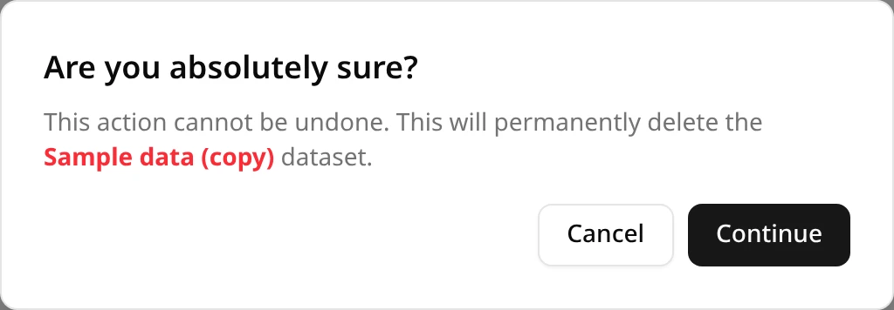

Your datasets live under **Datasets Controls**, at the top of the **Controls Center** on the left.

## Choosing a dataset

The dataset picker shows the selected dataset, or **Choose Dataset** when none is selected. Click
it to see your datasets, newest upload first, and type in **Search datasets...** to find one by
name. Click a dataset to select it.

- **Generate Schedule** works on the selected dataset, and is greyed out until one is selected.
  See [Generating a schedule](/docs/generating/generating-a-schedule).
- A dataset you've just uploaded is selected for you.
- ExamEngine remembers your choice in this browser. On another computer or browser, choose it
  again.
- The picker reads **No datasets** until you upload your first one.

Only your own datasets are listed. When someone shares a schedule with you, you don't get its
dataset: it stays theirs. ExamEngine administrators can see and download every user's datasets.

## The Current Dataset panel

Below **Upload CSV**, **Current Dataset** describes the selected dataset:

| Line | What it shows |
| --- | --- |
| **… courses** | The number of different CRNs in the courses file, including sections with no students, which get no exam. |
| **… students** | The number of different students (NUIds) in the enrollments file. |
| **… rooms** | The number of different room names in the rooms file. |
| **Large-only room:** *name* **(exams over** *n***)** | Only when the rooms file marks a large-only room: its name, and the size above which exams must use it. *n* is the capacity of the largest other room. See [The large-only room](/docs/your-data/csv-reference#the-large-only-room). |
| **Updated:** | How long ago the dataset was uploaded. After a week it shows the date. |

When some sections or groups can never be seated, an orange box lists them as **N groups or
sections will be unscheduled**, one per line:

- **CRN** *n* **(section)**: a section, in no group, with more students than the largest room
  seats.
- *Group name* **(combined)**: a combined exam whose sections together don't fit in the largest
  room.
- *Group name* **(common)**: a common exam that can't get a large enough room for each of its
  sections at once, with the reason.

These are the problems the upload warned about (see
[Warnings](/docs/your-data/uploading-a-dataset#warnings)), and they won't go away by generating
again. Students enrolled in two sections of one common exam were warned about at upload too, but
aren't listed here.

With no dataset selected, the panel reads **Select a dataset above**, or **Upload a dataset to get
started** if you have none.

## Changing a dataset

A dataset can't be edited or renamed after it's uploaded. To change anything, even one row,
correct the files and [upload them](/docs/your-data/uploading-a-dataset) as a new dataset, then
generate from it. Schedules you made from the old dataset stay as they are, tied to the old
dataset.

## Deleting a dataset

Select the dataset in the picker, click the trash icon next to it, and click **Continue** in the
**Are you absolutely sure?** dialog, which names the dataset. **Cancel** keeps it. The trash icon is
greyed out while no dataset is selected.

Deleting can't be undone. The dataset's uploaded files are removed, the dataset disappears from the
picker, and you can use its name again.

The schedules made from it are kept, and anyone they're shared with keeps them too. They show a red
**Deleted** badge next to the dataset's name, in the schedules list and on the schedule page. You
can still open them, use every tab, export, share and compare them. Whatever needs the uploaded
files no longer works:

- **Late Add** is greyed out. Pointing at it explains why.
- In **Explore**, looking up a student by NUId fails, and a room's blocked times are unavailable.
  Instructors, rooms and courses still work.
- **Validate Schedule** skips the checks that need the files.

So keep a dataset while you might still add a late exam to its schedules or validate them. See
[The dataset was deleted](/docs/reference/troubleshooting#the-dataset-was-deleted).
