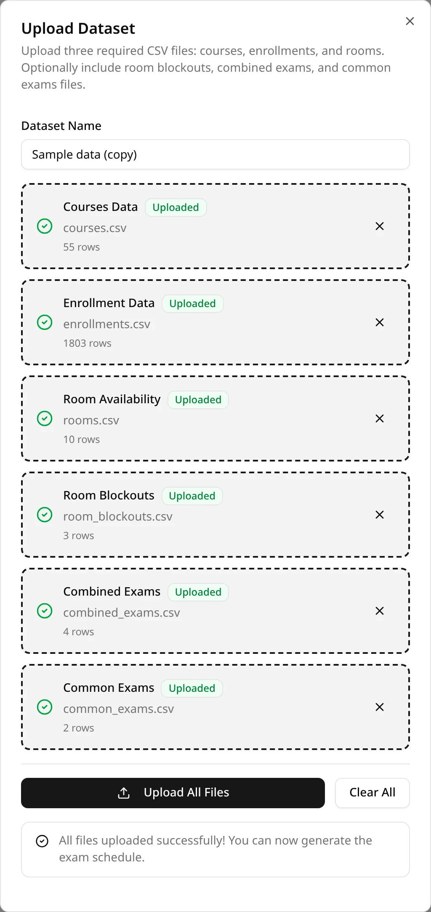
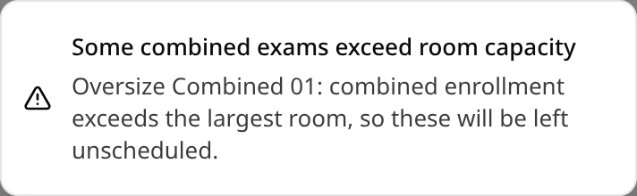
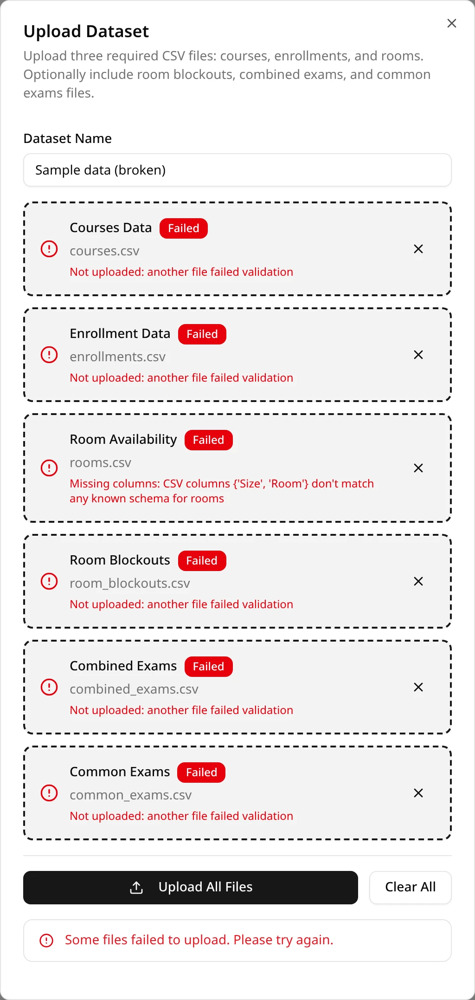

In the **Controls Center** on the left, under **Datasets Controls**, click **Upload CSV**. The
**Upload Dataset** dialog opens.

## Adding the files

1. **Name the dataset** under **Dataset Name**, for example `Fall 2025 finals`. The name has to be
   different from every other dataset you have. Capitalization counts, so `Fall` and `fall` are
   different names. You can reuse the name of a dataset you've deleted.
2. **Add a file to each box.** Click a box and choose the file. The first three boxes, **Courses
   Data**, **Enrollment Data** and **Room Availability**, are required. **Room Blockouts**,
   **Combined Exams** and **Common Exams** are marked **Optional**. Each box takes one file whose
   name ends in `.csv`; any other file shows **Invalid file type** and isn't added.
3. **Check the boxes.** An added file shows its name and **Ready**. To swap it for another file,
   click **×** to remove it, then click the box again.
4. Click **Upload All Files**.

**Upload All Files** is available once there's a name and at least one file. If one of the three
required boxes is still empty, the upload stops with **Required files are missing (courses,
enrollments, rooms)**. **Clear All** empties the name and every box.

The columns each file needs are in the [CSV reference](/docs/your-data/csv-reference).

## While it uploads

The button reads **Uploading...**, each box shows **Uploading...**, and an **Uploading dataset...**
message appears in the corner. ExamEngine checks every file before it saves anything.

## When the upload succeeds

- An **Upload successful!** message names the dataset and the number of rows in its courses file.
- Each box shows **Uploaded** and the number of rows in that file, and the dialog shows **All files
  uploaded successfully! You can now generate the exam schedule.**
- The new dataset is selected in the sidebar, under **Current Dataset**. See
  [Managing datasets](/docs/your-data/managing-datasets).

Close the dialog with **×**, or press Esc. It keeps the files and the name until you click **Clear
All**: clear it before you upload your next dataset, or the next upload reuses the same name and
fails. Then close the dialog and open it again before you add files: until then, choosing a file
you've already added once does nothing.

You can now [generate a schedule](/docs/generating/generating-a-schedule) from the dataset, as many
times as you like. The dataset is yours alone: it doesn't appear for other users, even ones you
share a schedule with.

## Warnings

Some problems don't stop the upload, but they mean some exams can never be seated. The upload
succeeds, and a warning appears for each kind of problem:

| Warning | What it means |
| --- | --- |
| **Some sections are larger than every room** | These sections have more students than the largest room seats. Lists each CRN and its enrollment. |
| **Some combined exams exceed room capacity** | The sections of these combined exams together have more students than the largest room seats. |
| **Some common exams cannot fit the room inventory** | Even with every room free, these common exams can't get a large enough room for each of their sections at once. Gives the reason for each. |
| **Students enrolled in multiple sections of a common exam** | Some students are enrolled in two sections of one common exam. Those sections sit at the same time in different rooms, so these students will be double-booked. |

The sections and groups from the first three warnings will be left unscheduled whenever you
generate from this dataset, with either engine. They stay listed in the sidebar under **Current
Dataset**, as **will be unscheduled**. To schedule them, fix the files (add a larger room, split a
group, or correct the enrollment) and upload them as a new dataset. More in
[Why exams end up unscheduled](/docs/generating/unscheduled-exams).

## When the upload fails

If any file has a problem, nothing is saved. A **Validation failed** message lists each file with
a problem and the reason. In the dialog, those boxes show **Failed** and the reason in red, and
the dialog shows **Some files failed to upload. Please try again.** The other boxes show **Not
uploaded: another file failed validation**: they were fine, but the upload is all or nothing.

To try again, click **×** on the failed box, then close the dialog and open it again: your files
and the name are kept. Add the corrected file to the empty box and click **Upload All Files**. The
other files are uploaded again with it. Closing and opening the dialog matters when the corrected
file has the same name as the one that failed: until then, the box doesn't notice the new file.

ExamEngine checks in this order, and stops at the first step that finds a problem:

1. The name: **Dataset of name: … already exists** if you already have a dataset with that name.
2. Each file on its own: that it isn't empty, is valid CSV, has the required columns, and for the
   rooms file, a valid large-only mark. The combined and common exams files are checked row by row.
   Every file's problems are listed together.
3. The combined and common exams files against the courses and rooms files: every CRN must be in
   the courses file with at least one student.

So after you fix one problem, the next upload can report another. What each message means and
what to do about it: [Troubleshooting](/docs/reference/troubleshooting#an-upload-fails) and the
[rules for the group files](/docs/your-data/csv-reference#rules-for-the-group-files).
